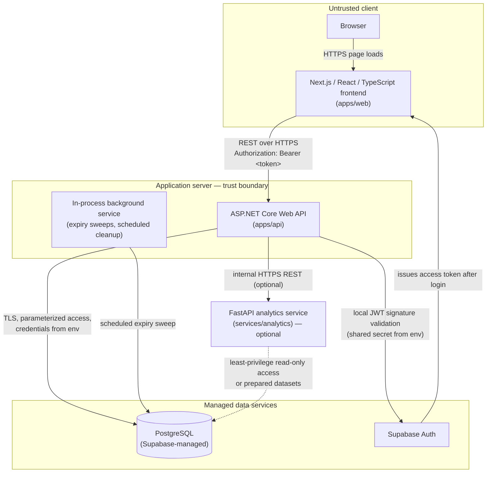

# CONFLUMIX — Technical Requirements Document

**The Multi-Mode Marketplace for Local Exchange.**

| Field | Value |
| --- | --- |
| Document | Technical Requirements Document (TRD) |
| Project | CONFLUMIX |
| Document purpose | Technical implementation reference for CONFLUMIX: architecture, components, interfaces, data model, security, testing, deployment, and implementation standards |
| Version | 1.0 (Initial) |
| Status | Draft for team confirmation and academic review |
| Date | 2026-10-16 |
| Document owner | CONFLUMIX Development Team (4 members) |
| Intended audience | Development team, academic supervisors and evaluators, testers, documentation contributors |
| Scope | Platform-wide technical requirements for the frontend, backend, database, analytics service, and their integration |
| Related documents | `README.md`, `AGENTS.md`, `docs/context.md`, `docs/structure.md`, `docs/requirements/PRD.md`, `docs/UI/UX_brief.md` |

> **Boundary note:** This TRD is the technical implementation reference for CONFLUMIX. It defines *how* the system is intended to work technically. It is distinct from the PRD (`docs/requirements/PRD.md`), which defines *what* the product should do and *why*, and from the UI/UX brief (`docs/UI/UX_brief.md`), which is the authoritative visual and interaction design document. This TRD does not claim that any described component, endpoint, table, or integration already exists unless explicitly labeled **Existing**.

---

## Table of Contents

1. [Document Control](#1-document-control)
2. [Project Overview](#2-project-overview)
3. [Project Goals and Technical Objectives](#3-project-goals-and-technical-objectives)
4. [Scope and Exclusions](#4-scope-and-exclusions)
5. [System Architecture](#5-system-architecture)
6. [Architectural Style and Design Principles](#6-architectural-style-and-design-principles)
7. [Technology Requirements](#7-technology-requirements)
8. [Repository and Project Structure](#8-repository-and-project-structure)
9. [Frontend Technical Requirements](#9-frontend-technical-requirements)
10. [Backend Technical Requirements](#10-backend-technical-requirements)
11. [Database Requirements](#11-database-requirements)
12. [Data Model and Domain Boundaries](#12-data-model-and-domain-boundaries)
13. [Authentication and Authorization](#13-authentication-and-authorization)
14. [API Design Requirements](#14-api-design-requirements)
15. [Shared Platform Services](#15-shared-platform-services)
16. [New Product Marketplace Requirements](#16-new-product-marketplace-requirements)
17. [Reuse / Old Product Marketplace Requirements](#17-reuse--old-product-marketplace-requirements)
18. [Task & Soft Skills Marketplace Requirements](#18-task--soft-skills-marketplace-requirements)
19. [Donation & Social Impact Network Requirements](#19-donation--social-impact-network-requirements)
20. [Cross-Mode Lifecycle Requirements](#20-cross-mode-lifecycle-requirements)
21. [Data Science Architecture](#21-data-science-architecture)
22. [Search, Filtering, Sorting, and Algorithms](#22-search-filtering-sorting-and-algorithms)
23. [Security Requirements](#23-security-requirements)
24. [Non-Functional Technical Requirements](#24-non-functional-technical-requirements)
25. [Transactions, Concurrency, and Idempotency](#25-transactions-concurrency-and-idempotency)
26. [File and Image Management](#26-file-and-image-management)
27. [Notifications and Background Work](#27-notifications-and-background-work)
28. [Testing Strategy](#28-testing-strategy)
29. [API and Data Documentation](#29-api-and-data-documentation)
30. [Deployment and Environment Configuration](#30-deployment-and-environment-configuration)
31. [CI/CD and Version Control](#31-cicd-and-version-control)
32. [Logging, Monitoring, and Auditability](#32-logging-monitoring-and-auditability)
33. [Technical Risks and Mitigations](#33-technical-risks-and-mitigations)
34. [Technical Decisions and Open Questions](#34-technical-decisions-and-open-questions)
35. [Implementation Roadmap and Dependencies](#35-implementation-roadmap-and-dependencies)
36. [Requirements Traceability](#36-requirements-traceability)
37. [Acceptance Criteria](#37-acceptance-criteria)
38. [Glossary](#38-glossary)
39. [References to Related Documentation](#39-references-to-related-documentation)

---

## 1. Document Control

### 1.1 Purpose

This document specifies the technical requirements for building CONFLUMIX. It is the reference the team implements against: it defines the agreed architecture, layer responsibilities, interfaces, data model boundaries, security posture, testing approach, deployment expectations, and implementation standards.

### 1.2 Status Labels

Every non-trivial claim in this document carries or implies one of the following labels. They are used explicitly in tables and requirement statements.

| Label | Meaning |
| --- | --- |
| **Existing** | Verified present in this repository at the time of writing (files, directories, configuration, documentation). |
| **Agreed** | Established project decision recorded in repository documentation (`README.md`, `AGENTS.md`, `docs/context.md`, `docs/structure.md`, `docs/requirements/PRD.md`). |
| **Proposed** | Recommended technical design in this document. Not yet implemented; requires implementation and, where noted, team approval. |
| **Optional** | Useful only if justified by a demonstrated requirement during implementation. |
| **Open Decision** | Unresolved choice requiring explicit team confirmation (see §34). |

### 1.3 Repository Evidence Summary (as of 2026-10-16)

Inspected before writing this document. Findings that shape this TRD:

| Area | Finding | Label |
| --- | --- | --- |
| Repository structure | `apps/web/`, `apps/api/`, `services/analytics/`, `docs/`, `tests/`, `scripts/`, `.github/` exist with placeholder `.gitkeep` files only | Existing |
| Application code | No source code, no `package.json`, no `.csproj`, no Python files anywhere | Existing |
| Database | No migrations, schema, connection configuration, or SQL files | Existing |
| Authentication | No implementation. Supabase Auth named as the agreed provider in `README.md`, `docs/structure.md`, `docs/context.md`, PRD `AS-08` / `FR-COM-001`; integration pattern with ASP.NET Core not established | Agreed (provider) / Open Decision (integration) |
| API | No controllers, routes, DTOs, or OpenAPI specification | Existing |
| Environment configuration | No `.env.example` or config samples; `.gitignore` already excludes `.env*` local files and key material | Existing |
| Testing | No test frameworks, test files, or test configuration; `tests/` folders are empty placeholders | Existing |
| CI/CD | `.github/workflows/` exists but contains no workflow files | Existing |
| Deployment | Frontend target Vercel (Agreed); backend and analytics hosting explicitly "To be decided later" in `README.md` | Agreed / Open Decision |
| Documentation | `README.md`, `AGENTS.md`, `docs/context.md`, `docs/structure.md`, `docs/requirements/PRD.md`, `docs/UI/UX_brief.md` present; brand image assets at repository root | Existing |
| Version control | Git repository initialized; no commits recorded at time of inspection | Existing |

**Consequence:** everything below §1–§8 that describes future application internals is **Proposed** unless labeled otherwise. No endpoint, table, service, or integration described here should be presented as working functionality.

### 1.4 Scope Boundaries

**This TRD defines:** system architecture, layer responsibilities, technology requirements, repository layout guidance, frontend/backend/database/analytics technical requirements, authentication and authorization design, API conventions, conceptual data model, domain boundaries, security requirements, non-functional targets, concurrency and idempotency rules, testing strategy, documentation obligations, deployment and configuration expectations, CI/CD workflow, logging and auditability, risks, open decisions, an implementation roadmap, and requirements traceability.

**This TRD does not define:** visual design rules (see `docs/UI/UX_brief.md`), product scope or feature priority (see `docs/requirements/PRD.md`), completed implementation artifacts, exact package versions (none exist yet), or quantitative performance guarantees (none have been measured).

### 1.5 Terminology

Terms are defined in §38 (Glossary). Requirement identifier conventions are defined in §36. PRD identifiers (`FR-*`, `NFR-*`, `BR-*`, `DEC-*`, `SM-*`) are used exactly as they appear in `docs/requirements/PRD.md`.

---

## 2. Project Overview

### 2.1 Core Description

> **CONFLUMIX is a unified multi-mode marketplace for local exchange that brings new product commerce, reuse of pre-owned goods, short-term remote problem solving, and donation-based resource sharing into one platform. It provides shared accounts, discovery, infrastructure, and data capabilities while preserving the distinct business workflows of each mode.** *(Agreed — `README.md`, PRD §2.2)*

### 2.2 The Four Marketplace Modes

| # | Mode | Exchange Type | Distinct Workflow Anchor |
| --- | --- | --- | --- |
| 1 | New Product Marketplace | Purchase of new goods | Cart → checkout → order → returns; bulk management; requirement checks |
| 2 | Reuse / Old Product Marketplace | Resale of pre-owned/refurbished goods | Offers → counteroffers → reservation lock → inspection → handover |
| 3 | Task & Soft Skills Marketplace | Short-term digital tasks | Problem-first publishing → proposals → solver selection → submission → completion |
| 4 | Donation & Social Impact Network | Donation of usable resources | Supply → need → claim → approval → handover → recorded impact |

The official mode name is **Task & Soft Skills Marketplace** (PRD); "Tasks" is acceptable only as a short navigational label (`docs/UI/UX_brief.md` §30.3).

These are **business modules within one platform — not four separate applications** (Agreed — `docs/context.md`, `docs/structure.md` §F).

### 2.3 Shared Platform Model

One unified account participates in all four modes (PRD `FR-COM-001`, `FR-XMD-004`). The platform shares:

- **Accounts and identity** — one login, context-dependent roles (buyer, seller, task owner, solver, donor, receiver), never a separate permanent account per role.
- **Discovery** — search, filtering, sorting, and location-aware listing discovery as a shared capability, not a fifth mode (PRD `FR-COM-004`, `FR-COM-005`).
- **Infrastructure** — one frontend application, one business API, one relational database, one deployment pipeline.
- **Cross-cutting services** — notifications, reviews where applicable, moderation, activity/audit history, file and image handling, administrative controls.
- **Data ecosystem** — structured data collected once, feeding shared analytics across modes (PRD `FR-COM-009`, `FR-DS-*`).

### 2.4 Shared Services vs. Domain-Specific Logic

| Shared (one implementation) | Mode-specific (four implementations) |
| --- | --- |
| Authentication, session validation, user identity | Order lifecycle (new products) |
| Profiles, roles, ownership checks | Offer and reservation lifecycle (reuse) |
| Search/filter/sort mechanics, pagination | Task lifecycle and proposal workflow (tasks) |
| Notifications, reviews framework, moderation | Claim, allocation, and handover workflow (donations) |
| Activity/audit recording, file metadata | Requirement checks, bulk rollback rules, benchmarks |
| Analytics data collection and reporting layer | Mode-specific state machines and validation rules |

**Rule:** shared infrastructure must not erase mode-specific workflows. A shared service exposes mechanics; each mode keeps its own business rules (PRD `NFR-MNT-001`, `BR-002`).

### 2.5 Shared Data Science Layer

One Python-based analytical layer (PRD `FR-DS-*`) serves all modes: data validation, cleaning, exploratory analysis, statistical summaries, and visualizations — including the fair-market price benchmark (reuse) and return-pattern analysis (new products). It is separate from the C# backend in codebase and responsibility (Agreed — `docs/structure.md`, PRD `NFR-MNT-003`).

---

## 3. Project Goals and Technical Objectives

### 3.1 Essential Technical Objectives

| ID | Objective | Rationale |
| --- | --- | --- |
| T-OBJ-01 | Maintainable architecture with clear layer and module boundaries | Four-person team, multiple academic subjects, iterative delivery (PRD `NFR-MNT-001`) |
| T-OBJ-02 | Reusable frontend components with a single design-token source | One visual system across four modes (`docs/UI/UX_brief.md`) |
| T-OBJ-03 | Explicit, documented API contracts consumed by a typed frontend | Prevents frontend/backend contract drift (PRD `NFR-MNT-004`) |
| T-OBJ-04 | Reliable relational data management with enforced integrity | Cross-mode consistency, audit history, correct lifecycles (PRD `NFR-REL-001`–`005`) |
| T-OBJ-05 | Secure authentication and server-side authorization | PRD `NFR-SEC-001`–`005` |
| T-OBJ-06 | Domain-specific validation per mode, centrally enforceable on the server | `BR-001`, `BR-002`, `BR-006` |
| T-OBJ-07 | Data integrity under concurrent activity (inventory, offers, reservations, claims) | `BR-005`, `BR-010`, `NFR-REL-002` |
| T-OBJ-08 | Testability: business rules isolated enough to unit-test without a browser | §28, `NFR-MNT-004` |
| T-OBJ-09 | Responsive, accessible frontend implementing the UI/UX brief | `NFR-CMP-001`, `NFR-CMP-002` |
| T-OBJ-10 | Explainable Data Science outputs: deterministic rules and statistics, never fabricated results | `BR-015`, `BR-016`, `FR-DS-010` |
| T-OBJ-11 | Practical deployment on free-tier-compatible hosting | Academic constraints (`CO-01`) |
| T-OBJ-12 | Academic feasibility for a four-student third-semester team | `CO-01`, `CO-02`, PRD `RK-01` |

### 3.2 Optional Enhancements (not objectives)

Justified only if time and capacity remain after Must Have scope (PRD §19.1) is demonstrable: email notifications, automated deployment pipelines, background analytics refresh jobs, advanced caching, CSV import/export beyond agreed scope, and any machine-learning component (none is required — PRD `AS-06`, §12.8).

---

## 4. Scope and Exclusions

### 4.1 In Scope

- One shared platform containing all four marketplace modes (PRD goal `G1`).
- Unified accounts, profiles, role-aware permissions, location-aware discovery, search/filter/sort (PRD `FR-COM-001`–`010`).
- New Product Marketplace: listings with category attributes, cart and demo checkout, orders, returns, bulk operations with preview and safe rollback, import/export, requirement checks, confidence summaries, alternatives, return-reason analytics, promotions, seller analytics (PRD `FR-NPM-*`).
- Reuse / Old Product Marketplace: listings with condition grades, offers and counteroffers, reservation locks with expiration, repair disclosure, price history, inspection checklists, handover, fair-market price benchmark, turnover analytics (PRD `FR-RUS-*`).
- Task & Soft Skills Marketplace: problem-first publishing, proposals, solver selection, submissions, revisions, completion, lifecycle validation (PRD `FR-TSM-*`).
- Donation & Social Impact Network: donation listings, resource requests, claims, approval, handover, urgency matching, impact reporting, claim controls (PRD `FR-DON-*`).
- Cross-mode lifecycle transitions with identity preservation and duplicate prevention (PRD `FR-XMD-*`).
- Shared analytics: structured export, validation/cleaning, EDA, per-mode and cross-mode analysis (PRD `FR-DS-*`).
- Management/administrative dashboards for moderation and platform administration (Proposed; scope bounded by PRD `FR-COM-002`, `FR-COM-008`).
- The agreed technology stack (§7).

### 4.2 Out of Scope Unless Explicitly Approved

The following are excluded (Agreed — PRD §6.2, §19.3). If any is requested later it requires an explicit team decision and a TRD revision.

| Excluded assumption | TRD position |
| --- | --- |
| Real banking integrations, payment settlement, escrow | Checkout and payment are **simulated/demonstrative** and must be labeled as such in the UI (PRD §7.5, `AS-04`) |
| Full logistics fleet management, route optimization | Pickup/handover coordination only (PRD §10.8) |
| Complex tax or accounting systems | Not modeled |
| Government identity or property database integrations | Verification states are **manual or simulated** and must not imply external verification (PRD `NFR-SEC-005`) |
| Full warehouse ERP/WMS | Bulk donation management is bounded (PRD §10.6) |
| Unnecessary AI recommendation engines, automatic skill matching, freelancer ranking | Deterministic rules and statistics only (PRD §9.5, §7.8) |
| Automatic charity auto-allocation | Rule-based or manual claim selection (PRD §10.7) |
| Enterprise microservices, message brokers, Kubernetes | Modular monolith (§6) unless a demonstrated requirement justifies otherwise |
| Blockchain, IoT, or unrelated technologies | Not introduced |
| Cash donations | In-kind only (PRD §10) |

Where payment, verification, delivery, or external integrations are simulated, the limitation must be visible in UI copy (PRD `NFR-SEC-005`, `NFR-USA-003`) and stated in documentation — never presented as a real integration.

---

## 5. System Architecture

### 5.1 Logical Architecture (Proposed)

The default architecture is a single-request path with an optional analytical side path:

```text
Browser
  → Next.js / React / TypeScript frontend
    → HTTPS REST API
      → ASP.NET Core / C# application backend
        → PostgreSQL database

Optional analytical path:
ASP.NET Core backend
  → Python FastAPI analytical service
    → Data Science processing
  → results returned to the backend
→ authorized frontend response
```

### 5.2 Architecture Diagram (Proposed — intended design, not a claim of existing components)



The diagram describes **intended** architecture. At time of writing, none of these components exist in code (**Existing:** none; all **Proposed**).

### 5.3 Layer Responsibilities

| Layer | Responsibilities | Must not do |
| --- | --- | --- |
| **Frontend** (`apps/web`) | Routing, rendering, layouts, client-side interaction, form input and client-side validation as UX aid, calling the backend API, presenting loading/error/empty states, implementing design tokens from `docs/UI/UX_brief.md` | Hold business authority; store secrets; access the database directly; call the analytics service directly; make final authorization decisions |
| **Backend API** (`apps/api`) | The single authority for business rules: endpoint implementation, request validation, authentication token validation, authorization (role/ownership/state), domain workflows and state machines, transactions, data access, audit records, serving OpenAPI documentation | Trust client-supplied ownership/privilege claims; return raw exception details to clients; embed presentation logic |
| **PostgreSQL** | Persistent relational storage, constraints, transactions, indexes, referential integrity, migration-managed schema | Hold application branching logic beyond what constraints enforce |
| **Analytics service** (`services/analytics`) | Optional: statistical computation, benchmarks, aggregates, charts for agreed analyses | Become a second marketplace business backend; accept writes to business tables; be called directly by the frontend |
| **Supabase Auth** | Identity: registration, login, token issuance, password recovery | Enforce marketplace business rules (authorization beyond identity is the backend's job) |

### 5.4 Trust Boundaries

1. **Browser ↔ API:** all data crossing this boundary is untrusted. Every request is validated and authorized server-side regardless of client behavior.
2. **API ↔ Database:** database credentials exist only in backend environment configuration. The frontend never receives connection strings, service-role keys, or SQL access (PRD `NFR-SEC-002`, `NFR-SEC-003`).
3. **API ↔ Analytics service:** internal call, not publicly exposed for business operations. The analytics service receives only the parameters and data it needs for a computation.
4. **Auth ↔ everything:** the access token is issued by Supabase Auth and validated locally by the backend (signature and expiry verification). Session strategy details are an Open Decision (§13, §34).

### 5.5 Authentication Context

- The frontend obtains an access token through Supabase Auth after login (**Agreed** provider; **Open Decision** on transport — §13.6).
- The frontend sends the token with API requests; the backend validates it and maps the identity to an internal user record.
- Authorization (role, ownership, verification state, workflow state) is evaluated **only** on the backend.
- The identity carried into business logic is the validated server-side principal, never a value supplied in the request body (e.g., `userId` fields in payloads are ignored or rejected).

### 5.6 Validation Flow

1. Transport-level: model binding and DataAnnotations (or equivalent) validation of request DTOs → `400` with Problem Details and field errors on failure.
2. Business-level: domain/state validation in the service layer (ownership, lifecycle state, eligibility, thresholds) → `403`/`404`/`409` as appropriate.
3. Data-level: database constraints (types, checks, uniqueness, referential integrity) as the final safety net.

Client-side validation duplicates rules only to improve responsiveness; it is never the enforcement point.

### 5.7 Error Handling

- Unhandled exceptions are caught by a centralized exception-handling middleware and mapped to RFC 9457 **Problem Details** responses (`application/problem+json`) (§14.5).
- Internal exception details, stack traces, SQL, and connection strings are logged server-side and **never** returned to the client.
- Expected domain failures (invalid transition, reservation conflict, insufficient stock) are modeled as typed exceptions or result objects mapped to specific status codes (`409 Conflict`, `422` where used, `403`).
- The frontend renders user-facing messages from Problem Details fields and displays retry/empty states appropriately.

### 5.8 Database Access

- All reads and writes go through the backend. No direct frontend database access, including "read-only" queries from the browser.
- Async I/O for all database operations (`async`/`await` end to end).
- Parameterized queries or ORM-generated SQL only (§23).
- Migrations are the sole mechanism for schema change; no runtime ad-hoc DDL (§11.6).

### 5.9 Analytical Data Flow (Proposed)

1. Operational tables accumulate structured marketplace data as a by-product of normal use.
2. Analysis operates on validated extracts: either prepared datasets (CSV/Excel exports, PRD `FR-DS-001`) or least-privilege read-only database access (**Open Decision**, §21.4).
3. The FastAPI service (when running as a deployed service) computes agreed outputs — e.g., fair-market benchmark, return-pattern aggregates — and returns structured JSON with adequacy metadata (`FR-DS-010`).
4. The backend calls the analytics service with a timeout; failure or slowness degrades to a "results temporarily unavailable" response. **Core marketplace transactions never depend on the analytics service** (§21.5).
5. Exploratory notebooks in `data-science/notebooks/`-equivalent paths remain offline and are not part of any request path.

### 5.10 Separation of Concerns and Dependency Direction

- Dependencies point inward: `Api → Application → Domain ← Infrastructure`. The domain layer does not reference web frameworks, the ORM, or the analytics client.
- The analytics service shares no code with the C# backend; it shares only data contracts (§21).
- Mode-specific features are isolated as modules (§6.2, principle 2) even though they live in one deployable backend.

### 5.11 Failure Handling Summary

| Failure | Behavior |
| --- | --- |
| Database unavailable | API returns `503` with Problem Details; frontend shows retry state; no partial writes committed |
| Analytics service timeout/error | Requested analytical feature returns a graceful "unavailable/insufficient" response; marketplace operations continue unaffected |
| Auth token expired/invalid | `401`; frontend refreshes or redirects to login |
| Concurrent state conflict | `409` with explanation; client re-fetches and re-renders current state |
| Background job failure | Logged with correlation ID; correctness of expiry flows does not depend solely on the job (§27.3) |
| Partial bulk operation failure | Per-item outcomes recorded; operation status reflects partial completion; rollback remains available for applied items (§16.A) |

---

## 6. Architectural Style and Design Principles

### 6.1 Recommended Style: Modular Monolith (Proposed)

The ASP.NET Core backend is a **single deployable application** organized into internal modules by marketplace mode and shared platform services.

| Why | Explanation |
| --- | --- |
| Team size and scope | Four students, academic timeline; one deployable unit minimizes operational overhead (`CO-01`) |
| Shared transactions | Cross-mode transitions and shared entities are simpler inside one database and one transaction boundary |
| Stack guidance | The agreed stack prescribes one backend (ASP.NET Core) and explicitly avoids unapproved architecture additions (§7 of this TRD; `docs/structure.md`) |

Microservices, message brokers, or Kubernetes are **not** introduced unless a demonstrated requirement (e.g., independently scaling analytical load) justifies them, and only after a recorded team decision (**Open Decision** gate, §34).

### 6.2 Design Principles

1. **Separation of concerns** — controllers bind and translate; services orchestrate; domain code owns invariants; infrastructure implements access.
2. **Domain boundaries** — each mode is a module with its own services, DTOs, validators, and state machines. Shared code lives in a distinct shared module; modes do not reach into each other's internals except through explicit cross-mode transition services (§20).
3. **Dependency injection** — all cross-cutting dependencies (DbContext, auth validation, storage, analytics client, clock) are registered in DI and injected; no service locators, no static mutable state.
4. **Thin endpoints** — controllers perform binding, authentication attributes, and calls into application services. No business logic in controllers.
5. **Service-layer business logic** — rules live in application services (or domain services for state machines), unit-testable without HTTP.
6. **Data access pragmatism** — use the ORM's `DbContext` (or equivalent) directly in application services by default. Add repository abstractions only where they remove real complexity (e.g., around a specific query pattern). **Avoid generic repositories** that merely wrap CRUD.
7. **DTO-based API contracts** — request/response shapes are explicit DTOs; domain entities are never serialized directly to clients.
8. **Centralized validation** — input validation at the DTO boundary; business validation in services; both reported in a consistent error format.
9. **Consistent exception handling** — one middleware mapping exceptions to Problem Details (§5.7).
10. **Configuration through environment variables** — no secrets or environment-specific values in code or committed config (§30).
11. **Shared services without duplicated rules** — e.g., one notification-creation service, one review-eligibility policy engine, parameterized per mode; not four copies of the same rule.
12. **No premature abstraction** — no generic "workflow engine," no speculative interfaces with a single implementation, no layered indirection that does not pay for itself (Rule B: avoid overengineering).

### 6.3 When a Simpler Structure Is Sufficient

A single ASP.NET Core project with folder-per-module boundaries is acceptable at the start if the team finds four projects too heavy. The deciding test: **can a developer locate a mode's rules, find its DTOs, and change them without fear of affecting another mode?** If folders achieve that, folders are enough. Split into multiple projects (§8.3) when compile-time isolation or test referencing makes it worthwhile — not to make the architecture "look sophisticated."

---

## 7. Technology Requirements

Version policy: **no project files with versions exist yet** (no `package.json`, `.csproj`, `requirements.txt`). Exact versions must be **selected and pinned during implementation** (lockfiles, pinned SDK versions, `requirements.txt` with constraints) and this section updated at that time. Do not invent version numbers in documentation.

| Technology | Status | Purpose & Responsibilities | Integration boundary | Configuration requirements | Constraints |
| --- | --- | --- | --- | --- | --- |
| **Next.js** | Agreed (`README.md`) | Frontend routing, rendering, layouts, page structure | Calls backend REST API over HTTPS; never touches DB or analytics directly | Node runtime version pinned; API base URL via public env var | No Next.js API routes as the main business backend |
| **React** | Agreed | Component model, interactive UI, state for UI concerns | Consumed within Next.js | — | Business-critical authorization never based on client state |
| **TypeScript** | Agreed | Frontend type safety; shared request/response types | DTO types mirror API contracts (§9.4) | `strict` mode enabled | No unnecessary `any`; no hardcoded secrets |
| **Tailwind CSS** | Agreed | Styling, responsive layout, design tokens per UI/UX brief | Design tokens defined once (§9.9) | Token theme aligned with `docs/UI/UX_brief.md` | No JavaScript animation libraries; CSS transitions preferred (`AGENTS.md`) |
| **ASP.NET Core (C#)** | Agreed | Business API: endpoints, validation, authorization, workflows, data access | Serves frontend; calls analytics service optionally; owns DB access | `ASPNETCORE_ENVIRONMENT`; connection strings; auth settings via env | Modular monolith; no second business backend |
| **PostgreSQL** | Agreed | Primary persistent relational store | Accessed only by backend (and approved least-privilege analytics reads) | Connection via environment variable; TLS required in cloud | Not to be replaced with a document DB |
| **Supabase** | Agreed as platform | Managed PostgreSQL hosting; Supabase Auth for identity; optionally storage and other managed services | Backend is the authority for business rules; Supabase Auth issues identity tokens | Project URL, anon key (frontend, if used), JWT secret / service credentials (backend only) | Supabase is **not** a separate database engine; each enabled capability must be explicitly selected (§13.3) |
| **Supabase Auth** | Agreed provider (`README.md`, PRD `AS-08`) | Registration, login, password recovery, token issuance | Frontend auth flows; backend validates tokens | JWT validation configuration on backend | Exact integration pattern = Open Decision (§13.6) |
| **Python + FastAPI** | Agreed | Optional isolated analytical endpoints; contract-only service | Called by backend; returns JSON; no business writes | Service URL on backend; own environment config | Must not become a second marketplace backend |
| **Pandas, NumPy** | Agreed | Data cleaning, transformation, statistical summaries | Used inside analytics service/notebooks | Pinned in requirements file | — |
| **Matplotlib, Seaborn** | Agreed | Analytical charts and exploratory visualizations | Notebook/output generation; static images | — | Not a frontend charting replacement for product UI |
| **Jupyter** | Agreed | Data Science workspace: notebooks, experiments, academic analysis | Offline; not in request path | — | Notebooks are not production endpoints (§21.6) |
| **Vercel** | Agreed (`README.md`) | Frontend hosting | Frontend deployment target | Env vars configured in platform; preview deployments optional | Confirm framework compatibility at scaffold time |
| **Render (or equivalent)** | Proposed; backend hosting open (README: "To be decided later") | ASP.NET Core hosting, if feasible | Backend deployment target | Same env var set as local; health check endpoint | **Open Decision** — confirm feasibility/free-tier limits (§34) |
| **Git & GitHub** | Agreed | Version control, branches, reviews, change tracking | CI via GitHub Actions (proposed) | Branch protection once team agrees | Never commit secrets (`.gitignore` already enforces patterns) |
| **REST over HTTPS** | Agreed | Frontend ↔ backend communication | JSON payloads; versioned base path (§14.2) | HTTPS enforced in deployment | No non-HTTPS production communication |

---

## 8. Repository and Project Structure

### 8.1 Established Structure (Existing)

The repository structure is defined in `docs/structure.md` and exists on disk (directories with `.gitkeep` placeholders only). It is authoritative and **must be followed rather than replaced**:

```text
CONFLUMIX/
├── apps/
│   ├── web/                  # Next.js frontend (not yet scaffolded)
│   └── api/                  # ASP.NET Core Web API (not yet scaffolded)
├── services/
│   └── analytics/            # Python FastAPI analytics service (not yet scaffolded)
├── docs/
│   ├── structure.md          # Repository structure rules
│   ├── context.md            # Shared project context
│   ├── requirements/PRD.md   # Product requirements
│   ├── UI/UX_brief.md        # Design system
│   ├── TRD.md                # This document
│   ├── architecture/         # Future architecture docs (empty)
│   ├── diagrams/             # Future diagrams (empty)
│   ├── api/                  # Future API specs (empty)
│   ├── data-science/         # Future data-science docs (empty)
│   ├── testing/              # Future testing docs (empty)
│   └── project-management/   # Future planning docs (empty)
├── tests/
│   ├── frontend/  ├── backend/  └── analytics/    # Empty placeholders
├── scripts/                  # Future dev/maintenance scripts (empty)
├── .github/
│   ├── ISSUE_TEMPLATE/       # Empty
│   └── workflows/            # Empty (no CI yet)
├── .gitignore                # Existing: Node/.NET/Python/secret exclusions
├── README.md                 # Existing
└── AGENTS.md                 # Existing
```

**Note:** the task brief's alternative tree (`frontend/`, `backend/`, `data-science/`) is **not adopted**, because the repository has already established `apps/` + `services/` conventions (`docs/structure.md` §C). Conflicting structures must not be introduced.

### 8.2 Recommended Internal Layout Inside Each Application (Proposed)

When applications are scaffolded, the following internal structure is recommended. It is a recommendation for implementation tasks, not a claim that it exists.

```text
apps/web/
├── src/
│   ├── app/                  # Next.js App Router: routes, layouts, loading/error files
│   │   ├── (auth)/           # login, register, recovery
│   │   ├── (platform)/       # shared: home, search, profile, notifications, admin
│   │   ├── products/         # New Product Marketplace pages
│   │   ├── reuse/            # Reuse / Old Product pages
│   │   ├── tasks/            # Task & Soft Skills pages
│   │   └── donations/        # Donation & Social Impact pages
│   ├── components/           # Shared design-system components (buttons, inputs, cards…)
│   ├── features/             # Mode-specific composed components (per mode folder)
│   ├── lib/                  # API client, auth helpers, formatters, constants
│   ├── hooks/                # Reusable React hooks (data fetching wrappers, UI state)
│   ├── types/                # TypeScript DTO types mirroring API contracts
│   └── styles/               # Tailwind entry, token layer
├── public/                   # Static assets (brand images relocated here per UX brief §30.2)
└── tests/                    # Component/interaction tests (maps to tests/frontend/)

apps/api/
├── src/
│   ├── Conflumix.Api/            # Controllers, middleware, DI wiring, Program.cs
│   ├── Conflumix.Application/    # Use-case services, DTOs, validators, interfaces
│   ├── Conflumix.Domain/         # Entities, value objects, state machines, invariants
│   └── Conflumix.Infrastructure/ # EF Core (or chosen data access), auth validation, storage, analytics client
└── tests/
    ├── Conflumix.UnitTests/
    └── Conflumix.IntegrationTests/   # (tests/backend/ mirrors these assets per docs/structure.md)

services/analytics/
├── src/                    # FastAPI app: routers, schemas, services
├── notebooks/              # Jupyter EDA notebooks (exploratory only)
├── tests/                  # Pytest suites
├── requirements.txt        # Pinned dependencies
└── README.md               # How to run, contracts, limitations
```

### 8.3 When Layered Backend Projects Are Justified

| Situation | Recommendation |
| --- | --- |
| Initial scaffold, small team, few features | **Two projects acceptable:** `Conflumix.Api` + `Conflumix.Domain`… in practice, start with the four-project split only if the team agrees it will maintain it. A single web project with strict folders is a valid Stage-1 choice (§6.3) |
| Four modes + shared services with growing rules | **Four-project split justified:** compile-time enforcement that Domain has no EF/HTTP dependencies, Application has no controllers, tests can reference Application/Domain without booting the web host |
| Tests need business rules without HTTP | Layered split makes unit testing straightforward — a real requirement (§28) |
| To "appear sophisticated" | **Never** the reason (Rule B) |

Decision: record the chosen structure when scaffolding occurs (**Open Decision** until then, §34).

---

## 9. Frontend Technical Requirements

All items in this section are **Proposed** implementation requirements unless noted. Visual design rules are governed by `docs/UI/UX_brief.md`; this section states only the technical constraints needed to implement that document consistently.

### 9.1 Routing and Page Organization

- Use the Next.js App Router with route groups mirroring the four modes plus shared platform routes (§8.2).
- Each mode's routes live under its own top-level segment; shared pages (home, search entry, profile, notifications, admin) live in a shared group. Mode-specific UI must not be scattered through shared folders.
- Shared layouts provide the navbar, mode switching, and footer; mode layouts provide mode chrome (per UX brief §9.5).
- Server and client component boundaries: **server components by default** for initial page data and static content; client components explicitly marked for interactivity (forms, dialogs, filters with live state, optimistic UI).

### 9.2 Component Structure and Reuse

- Design-system primitives (buttons, inputs, cards, badges, tables, modals, toasts, skeletons) are built once in `components/` and consumed by all modes.
- Mode-specific composed components live under `features/<mode>/` and may only use shared primitives, not re-implement them.
- Components are typed props-first; no `any` props; shared types live in `types/`.

### 9.3 TypeScript Strictness

- `strict: true` in `tsconfig.json`.
- **No unnecessary `any`** — unknown is preferred for untrusted input, narrowed before use.
- API request/response types are declared once and shared; inline object-literal typing of API shapes inside components is prohibited.

### 9.4 API Communication

- A single typed API client module (`lib/api/`) owns: base URL resolution, authentication headers/token attachment, JSON serialization, Problem Details parsing, and error normalization.
- Components and feature hooks consume the shared client; **duplicated fetch logic scattered through components is prohibited**.
- No API call is made with credentials embedded in code; only public configuration via `NEXT_PUBLIC_*` env vars (§30).
- The frontend **never** calls the analytics service directly (`docs/structure.md` §E; PRD `FR-DS-009` acceptance: frontend does not call it).

### 9.5 Data Fetching and Mutation

- Read-heavy public pages: server-side fetching in server components with caching appropriate to data volatility (Proposed; specific Next.js caching strategy selected at implementation).
- Interactive flows (cart, offers, claims, forms): client-side mutation through the shared API client with explicit loading, success, and error states.
- Mutations revalidate or re-fetch affected data rather than mutating local state to fake server results.
- **No fake API responses in production flows.** Mock data is permitted only in storybook-style previews or clearly labeled development fixtures, never behind a real user action path.

### 9.6 Form Validation

- Client-side validation mirrors server rules for responsiveness (required fields, ranges, formats).
- Server validation is authoritative; the client renders field errors returned in Problem Details `errors`.
- Validation UX (inline messages, error summary, focus management) follows `docs/UI/UX_brief.md` §11.5 and accessibility requirements (§9.10).
- Form library choice is an **Open Decision** (§34): native React forms are acceptable initially; a library (e.g., react-hook-form + zod) requires team approval as an added dependency.

### 9.7 Error, Loading, and Empty States

Every data view defines four states: loading (skeleton per UX brief §19), success, empty (with guidance), error (with retry). API failures map to user-readable messages; raw payloads are never shown.

### 9.8 Authentication-Aware Navigation and Route Protection

- Session state determines rendering of navigation entries (login/register vs. profile/notifications) and gated pages.
- Route protection uses Next.js middleware/server-side session checks as a **UX convenience**; the backend independently enforces authorization on every request. Client-side route guards are never the security boundary (§23).
- Redirects to login preserve the intended destination for post-login return.

### 9.9 Design Tokens

- Colors, typography, spacing, radii, shadows, motion durations/easings are defined as CSS custom properties/Tailwind theme tokens per `docs/UI/UX_brief.md` §24–25 — single source, no ad-hoc hex values in components.
- Mode accent colors derive from the shared token layer (UX brief §9).
- Reduced-motion support via the brief's §15.11 rules (CSS media query, not JS).

### 9.10 Responsive and Accessible Interaction

- Responsive behavior across agreed breakpoints (UX brief §20; canonical breakpoint scale = UI-DEC-007).
- Accessibility: keyboard operability, visible focus, semantic landmarks, form labels, live regions for async status, sufficient contrast — targeting **WCAG 2.2 AA** where applicable (UX brief §21; §24.6 of this TRD).
- Performance: avoid unnecessary re-renders, lazy-load heavy views, optimize images (next-gen formats, sizing), respect visual stability rules (UX brief §26).

### 9.11 Frontend Prohibitions (normative)

- No hardcoded secrets or API keys; no database credentials anywhere in frontend code (PRD `NFR-SEC-002`, `NFR-SEC-003`).
- No business-critical authorization decision based only on client-side state.
- No direct database or analytics-service access from the browser.
- No fake/simulated responses presented as real outcomes in production flows (simulated payment must be *labeled* simulated, per PRD §7.5).
- No new UI technology outside the agreed stack (Next.js/React/TypeScript/Tailwind) without a team decision (`AGENTS.md`).

---

## 10. Backend Technical Requirements

All **Proposed** unless noted. Stack: ASP.NET Core Web API, C# (**Agreed**).

### 10.1 Endpoint Responsibilities

- Endpoints expose use cases for the four modes and shared services per §14; they bind requests to DTOs, validate, invoke application services, and shape responses.
- Controllers contain no business rules (§6.2 principle 4).

### 10.2 Authentication Integration

- Validate Supabase-issued access tokens on every authenticated endpoint (JWT signature/expiry validation using backend-held configuration) — pattern details in §13.6 (**Open Decision**).
- Map token subject (`sub`) to the internal user record; treat missing/unknown users as unauthenticated.
- Anonymous access is explicit (e.g., `[AllowAnonymous]` only on genuinely public reads).

### 10.3 Authorization

- Enforce: role/permission checks, **resource ownership validation**, verification-state requirements, and workflow-state preconditions — all server-side (PRD `FR-COM-002`, `BR-001`).
- Never trust client-supplied ownership or privilege claims (request-body `userId`, `isOwner`, `role` fields are not authoritative).
- Authorization failures return `403` (authenticated but not permitted) or `404` where revealing existence would itself leak information.
- Administrator privileges are restricted to explicit platform-admin principals (§13.5).

### 10.4 Validation

- DTO-level validation (DataAnnotations or an approved equivalent) → `400` Problem Details with field errors.
- Business-rule validation in services → typed results mapped to `400`/`403`/`404`/`409`.
- Category-attribute validation against the category's attribute schema (§16.B) at write time.
- Validation of collections: enforce maximum page sizes, batch sizes (§16.A batch limits, DEC-010), and import row limits.

### 10.5 Business Rules and Domain Workflows

- Each mode implements its documented state machine (§16–§20) with explicit allowed transitions; invalid transitions are rejected with `409` and an explanation.
- Rules from the PRD (`BR-001`–`BR-016`) must be implemented once, in the appropriate service, and unit-tested (§28).
- Deterministic mechanisms (requirement checks, confidence summaries, urgency matching, promotion conflicts, benchmarks) contain no hidden randomness and are explainable by construction (PRD `BR-016`).

### 10.6 Data Access and Transactions

- Async I/O for all database and network calls; no blocking calls on request threads.
- Transaction boundaries defined per use case: multi-row/state changes commit atomically (§25); single-resource reads need no explicit transaction.
- Sensitive operations use conditional updates/concurrency tokens (§25.2).
- Migrations manage schema; no runtime DDL.

### 10.7 Error Handling, Logging, and Responses

- Centralized exception middleware → RFC 9457 Problem Details (§5.7, §14.5).
- Structured logging with correlation IDs; never log passwords, tokens, secrets, or full personal payloads (§32).
- Consistent HTTP status usage (§14.4) and consistent response envelopes (§14.3).

### 10.8 Configuration

- All environment-specific values via environment variables / platform config (§30): connection string, auth settings, CORS origins, feature toggles, reservation TTL, analytics URL.
- Options pattern binding in ASP.NET Core; configuration validated at startup (fail fast on missing required values).
- No secrets in source control; `.gitignore` already excludes env/secret files (**Existing**).

### 10.9 Background Work

- Justified only for: reservation expiry sweeps, scheduled cleanup (expired drafts/tasks), optional notification digests, optional analytics refresh (§27).
- Implemented as in-process hosted services (or the chosen approved mechanism — §34); no message broker (§6.1).
- Correctness of user-facing flows must not depend on a job having run (lazy validation on action, §27.3).

### 10.10 API Documentation

- OpenAPI generation (Swashbuckle or built-in Microsoft.AspNetCore.OpenApi — chosen at scaffold) serving `/swagger` (dev) and a committed/spec output under `docs/api/` (§29).
- Every endpoint documented: auth requirement, request/response DTOs, validation rules, possible error statuses.

### 10.11 Testing Support

- Endpoints designed for testability: services injectable, time (`IClock`) injectable for expiry logic, no static context access.
- Integration tests exercise real HTTP + database (§28.2).

### 10.12 Backend Prohibitions (normative)

- No internal exception detail exposure to clients.
- No business-critical logic implemented only in the frontend.
- No trusting client identity claims without server validation.
- No direct exposure of the database to anything but the backend (and approved least-privilege analytics access).
- No second business authority in the analytics service or in Supabase row-level logic acting alone (§13.3).

---

## 11. Database Requirements

PostgreSQL is the primary persistent data store (**Agreed**), hosted on Supabase-managed PostgreSQL (**Agreed** platform). Supabase is not a different engine — the data model must be portable standard PostgreSQL.

### 11.1 Relational Modeling

- Normalized core schema (3NF target) with deliberate denormalization only where justified by read performance (documented at implementation).
- Strong typing: proper column types (`numeric(12,2)` for money, `timestamptz`, `uuid`/`bigint` keys, `text` with check constraints for enumerated vocabularies, `jsonb` only for genuinely flexible attribute payloads validated at write time).

### 11.2 Keys and Constraints

| Requirement | Rule |
| --- | --- |
| Primary keys | Surrogate (`bigint` identity) or UUID — pick one convention per entity group and keep it consistent; recommended: UUID for externally exposed resources, identity for internal high-volume rows (**Open Decision** at schema time) |
| Foreign keys | Every relationship enforced by FK; `ON DELETE` behavior explicit (usually `RESTRICT` for business records, `CASCADE` only for owned child rows like cart items) |
| Unique constraints | Natural uniques (e.g., one active reservation per listing, one open claim per user per listing, unique slug/email per profile where applicable) |
| Check constraints | Enumerations, non-negative quantities/prices, valid ranges (`stock >= 0`, `amount > 0`) |
| Not-null | Required business fields enforced in DB, not only in app |

### 11.3 Indexing (Proposed baseline)

- FK columns indexed (join paths).
- Listing/search paths: status + category, price, `created_at`, locality — aligned with §22 query patterns.
- Partial indexes for active-state queries (active listings, active reservations, pending claims).
- Text search: start with `ILIKE`/trigram (`pg_trgm`) only if needed; do not pre-create exotic index structures (§22.5).
- Index usage validated with `EXPLAIN ANALYZE` before adding further indexes; avoid over-indexing writes.

### 11.4 Transactions and Referential Integrity

- Multi-step writes (checkout, offer acceptance + reservation, claim approval, cross-mode transitions, bulk operations) run inside database transactions (§25).
- Referential integrity is a hard requirement; application-level checks do not replace constraints.
- Application code never bypasses constraints for convenience.

### 11.5 Data Validation and Timestamps

- Write-time validation mirrors category/attribute schemas (§16.B); DB checks cover invariants that must hold regardless of code path.
- **All timestamps stored in UTC** (`timestamptz`), application clock normalized to UTC, presentation converted to user-local time in the frontend where appropriate.
- Every business table carries `created_at`/`updated_at` maintained by the application (or DB trigger — chosen convention at schema time).
- Soft lifecycle fields: prefer explicit status columns over destructive deletes for business records; hard delete only where privacy/retention policy requires it (**Open Decision** with PRD `DEC-007`).

### 11.6 Migration Management

- Schema changes **only** through versioned migrations committed with the code that depends on them, reviewed in PRs (§31.4).
- Migration naming and ordering deterministic; no destructive migration without a documented rollback/expand-contract plan (§30.8).
- Seed data: reference categories/attribute schemas/lookup reasons as idempotent seed migrations; no fabricated business transactions as seeds (PRD §12.7 prohibition on fabricated insights extends to seed-derived analytics).

### 11.7 Pagination and Query Performance

- All potentially large list endpoints are paginated (§14.7); unbounded `SELECT *` over business tables is prohibited.
- N+1 query patterns prohibited; use projection and includes/joins deliberately (§24.1).
- Query performance targets are **proposed** until measured (§24.1).

### 11.8 Backup and Recovery

- Rely on the hosting platform's managed backups (Supabase provides PITR on paid tiers — verify at selection time; **Open Decision** on tier).
- For academic scope: an agreed baseline is (a) platform-managed daily backup where available on the chosen tier, (b) periodic manual `pg_dump` export stored outside the repo (script in `scripts/`, output never committed), (c) migrations in Git = schema recovery path.
- Document restore steps in `docs/` when the database is first provisioned (follow-up work).

### 11.9 Current Status

**Existing:** no schema, no migrations, no database configuration in the repository. Everything above is **Proposed**.

---

## 12. Data Model and Domain Boundaries

> **Status of this section:** all entities below are **conceptual candidates** derived from PRD requirements. Nothing is implemented. The final schema must be derived from migrations written against actual requirements — entities may be consolidated where doing so preserves domain boundaries and integrity. IDs in this section are illustrative, not committed schema.

### 12.1 Boundary Rules

1. **Shared tables hold shared facts** (identity, location, notification, review, audit, asset metadata). They do not hold mode-specific workflow state (no "status" of a donation on the `user` table).
2. **Mode tables hold mode workflow state** and reference shared tables by FK.
3. **Cross-mode relationships** exist only through explicit transition records (§12.7) — not by sharing a mutable "item status" column across modes.
4. A single user row serves all modes (§13.1); roles/capabilities are assignments, not duplicate accounts.

### 12.2 Shared Platform Entities (Proposed)

| Entity | Responsibility | Key relations |
| --- | --- | --- |
| `UserAccount` | Maps Supabase Auth identity (`sub`) to internal user; status (active/suspended) | 1–1 `UserProfile`; referenced by all owned records |
| `UserProfile` | Display name, avatar, bio, locality, contact visibility settings | `UserAccount`, `Address` |
| `RoleAssignment` | Contextual capabilities (e.g., `platform_admin`, `verified_seller`) with optional scope | `UserAccount` |
| `Address` / locality reference | Structured location for discovery (no GPS tracking) | `UserProfile`, listings |
| `Notification` | In-app notification records: type, recipient, payload ref, read state | `UserAccount` |
| `Review` | Rating + text attached to a completed interaction, per eligibility rules (PRD `DEC-009`) | subject user or record, source transaction |
| `ModerationRecord` | Flag/decision history for listings or users | target record, admin actor |
| `ActivityRecord` | Append-only audit: actor, action, entity type/id, timestamp, before/after snapshot where required | referenced entities |
| `UploadedAsset` | File metadata: storage key, mime, size, owner, purpose | owner; referenced by listings/messages |

### 12.3 New Product Marketplace Entities (Proposed)

| Entity | Responsibility |
| --- | --- |
| `ProductCategory` (+ attribute definitions) | Category tree; per-category attribute schema driving §16.B checks |
| `ProductListing` | Seller's product offer: title, description, category, attributes, status, seller |
| `ProductVariation` / `InventoryRecord` | Variation rows (size/color/etc.) and stock counts where the category uses them |
| `Cart` / `CartItem` | Buyer's pending selections (validated again at checkout) |
| `Order` / `OrderItem` | Simulated checkout records with status history (PRD `FR-NPM-010`) |
| `ReturnRequest` + `ReturnReason` | Structured return/cancellation with reason vocabulary (§16.E) |
| `Promotion` | Discount definitions with scope and period (conflict checking §16.F) |
| `BulkOperation` | Operation header: type, status, preview snapshot, actor, timestamps |
| `BulkOperationItem` | Per-record: before/after values, eligibility, skip reason, applied/rolled-back state |
| `RollbackRecord` | Rollback attempt header + per-item outcomes (may be modeled as a second `BulkOperation` of type rollback — decide at schema time) |
| `PurchaseRequirement` | Optional saved buyer requirement sets (for §16.D alternatives) |
| `CompatibilityResult` | Optional persisted evaluation record (§16.B) for analytics — computation can otherwise be on-demand |

**Consolidation note:** `ProductVariation` and `InventoryRecord` may merge; `RollbackRecord` may be a `BulkOperation` subtype. Decide against real query patterns, not theoretical completeness.

### 12.4 Reuse / Old Product Marketplace Entities (Proposed)

| Entity | Responsibility |
| --- | --- |
| `UsedProductListing` | Pre-owned listing: condition grade, category attributes, disclosure flags, status |
| `ConditionAssessment` | Structured condition data where a single grade is insufficient |
| `RepairDisclosure` | Chronological repair/maintenance entries (component, date, type, classification, notes, warranty note) |
| `PriceHistoryEntry` | Append-only asking-price snapshots with dates (§17.5) |
| `Offer` | Offer/counteroffer chain: amount, party, state (pending/accepted/rejected/withdrawn/expired) |
| `Reservation` | Lock created on acceptance: holder, expiry, state (§17.7) |
| `InspectionChecklist` (+ items) | Category-based checklist instance for a listing/handover |
| `HandoverRecord` | Confirmation of physical exchange: time window, confirmation code, parties |
| `ReuseOrder` | Demonstrative checkout/order record for reuse transactions (PRD `FR-RUS-016`) |

### 12.5 Task & Soft Skills Marketplace Entities (Proposed)

| Entity | Responsibility |
| --- | --- |
| `Task` | Problem description, expected outcome, budget, deadline, status (lifecycle §18.2), owner |
| `TaskCategory` | Category taxonomy for discovery |
| `Skill` / `TaskSkill` | Skill vocabulary and task-skill links (descriptive, not a matching engine) |
| `Application` (Proposal) | Solver's proposal: message, bid/price, state (submitted/withdrawn/accepted/rejected) |
| `Assignment` | Selected solver binding for a task (may be derived from accepted application — consolidate at schema time) |
| `Submission` | Solver's delivered work: text/files, timestamp, state |
| `RevisionRequest` | Owner's request for changes: feedback, cycle number |
| `CompletionRecord` | Completion fact: who confirmed, when, outcome |
| `TaskReview` | Post-completion feedback (subject to review eligibility rules) |

### 12.6 Donation & Social Impact Network Entities (Proposed)

| Entity | Responsibility |
| --- | --- |
| `DonationListing` | Offered resources: category, condition (agreed vocabulary), quantity, pickup info, urgency, status |
| `ResourceRequest` (Need) | Stated need: category, quantity, intended use, urgency, requester |
| `OrganizationProfile` | NGO/community/organization details for donor/receiver contexts (manual/simulated verification states) |
| `Claim` | Request against a listing: need statement, state (pending/approved/rejected/withdrawn), anti-duplicate controls |
| `AllocationRecord` | Who received how much of what (supports partial quantity allocation) |
| `HandoverRecord` | Pickup/drop-off window, confirmation code/QR result, completion timestamp |
| `DonationImpactRecord` | Impact entries distinguishing **recorded counts** from **estimated metrics** with assumptions (PRD `BR-015`) |

### 12.7 Cross-Mode and Analytics Entities (Proposed)

| Entity | Responsibility |
| --- | --- |
| `CrossModeTransition` | Links source record → destination record, mode pair, initiator, confirmation, provenance snapshot, timestamp (§20.3) |
| `AnalyticalDatasetDefinition` | Documented dataset shape for exports (fields, filters) — may live as documentation + export code rather than a table |
| `AggregateMetric` (or materialized views) | Cached computed metrics with as-of timestamp and definition version (return rates, benchmark inputs) |
| `DataQualityRecord` | Data-quality findings (missing fields, invalid values) where justified |
| `ReturnPatternAggregate` | Per product/category return statistics with sample size and window |
| `FairMarketPriceAggregate` | Precomputed benchmark inputs/outputs with `n`, percentile range, limitations |

**Note:** analytics entities may be replaced by SQL views or on-demand computation in early stages — choose per measured need (**Optional**).

### 12.8 Shared vs. Mode-Specific Data Summary

| Data | Shared or mode-specific | Cross-mode relationship mechanism |
| --- | --- | --- |
| Identity, profile, roles | Shared | — |
| Location/locality | Shared | Used by all modes' discovery |
| Reviews | Shared framework, per-mode eligibility rules | Subject type resolved polymorphically (documented) |
| Notifications | Shared infrastructure, mode-specific event types | Event source ref (type + id) |
| Product/purchase history | New-product mode | Provenance into reuse via `CrossModeTransition` |
| Used listings / reuse transactions | Reuse mode | Transition into donation via `CrossModeTransition` |
| Tasks, proposals, submissions | Task mode | None (tasks are not physical items; no lifecycle transfer) |
| Donations, claims, handovers | Donation mode | Destination side of transitions from new/reuse |
| Audit/activity records | Shared append-only journal | Entity type + id references across modes |
| Analytics | Shared layer over mode data | Reads mode tables; writes only aggregate/quality tables |

---

## 13. Authentication and Authorization

### 13.1 Requirements

| # | Requirement | Status / PRD ref |
| --- | --- | --- |
| A-01 | Registration, login, logout, and password recovery provided through the agreed identity provider | Agreed provider: Supabase Auth |
| A-02 | One account participates in all four modes; roles are contextual assignments, not separate accounts | Agreed — `FR-COM-001`, `FR-XMD-004` |
| A-03 | Session/token handling supports expiry and revocation (logout invalidates the client session; expired tokens rejected) | Proposed |
| A-04 | Every sensitive endpoint performs server-side role + ownership + state checks | Agreed — `FR-COM-002`, `NFR-SEC-001` |
| A-05 | Administrative access restricted to explicit admin principals; admin actions audited | Proposed; PRD `FR-COM-008` |
| A-06 | Rate limiting on sensitive endpoints (login attempts, password recovery, high-cost computations) | Proposed |
| A-07 | Never store plaintext passwords; the backend never sees passwords if flows go directly through the identity provider | Agreed — `NFR-SEC-002` |
| A-08 | Verification states (Unverified / Basic Verified Citizen / Local Business Verified) are manual or simulated, set by admin action, and never imply government integration | Agreed — `FR-RUS-002`, `NFR-SEC-005` |

### 13.2 Contextual Roles

Users act in contexts (buyer, seller, donor, receiver, task owner, solver, admin) without permanent per-mode accounts. The model (Proposed, pending PRD `DEC-002`):

- **Global principals:** `platform_admin` (privileged), `user` (default).
- **Contextual capabilities:** granted by action + ownership (any user may list, claim, publish — subject to per-action checks) or by verifiable attributes (e.g., `organization_verified` for organization profiles).
- Authorization predicates combine: `authenticated && owns(resource) && resource.state allows(action) && capability present`.

### 13.3 Supabase Capability Selection

Supabase offers many services. **Selected** (agreed) vs. **not assumed:**

| Supabase capability | Status | Notes |
| --- | --- | --- |
| Managed PostgreSQL | **Agreed** | Primary database |
| Supabase Auth | **Agreed** as provider | Identity only; business authorization in ASP.NET Core |
| Supabase Storage | **Optional / Open Decision** | Candidate for file storage (§26.3); not assumed until selected |
| Supabase Edge Functions | **Not selected** | Business logic stays in ASP.NET Core |
| Supabase direct frontend DB access (JS client queries) | **Not selected** | Violates `NFR-SEC-003` for business data; backend mediates |
| Row-Level Security as defense-in-depth | **Open Decision** | See below |

**Position:** ASP.NET Core remains the authority for business rules. Whether the database also enforces RLS policies (defense-in-depth) is an open decision — RLS-first designs often tempt teams into putting business logic in the database; if adopted, policies must be limited to coarse ownership guards and documented (§34).

### 13.4 Identity Flow (Proposed coherent architecture)

1. Frontend calls Supabase Auth (via the Supabase client) for register/login/recovery; Supabase issues an access token (JWT) and manages the session.
2. Frontend includes the token on API requests (transport — §13.6).
3. ASP.NET Core validates the JWT locally (secret/JWKS configuration from environment) and resolves the internal `UserAccount` by `sub` (creating a pending profile row on first login if needed).
4. Authorization policy evaluates role/ownership/state server-side for each request.
5. Passwords are handled exclusively by Supabase Auth; the backend stores no password material.

**Why this architecture:** one identity authority (no duplicate credential stores), aligned with the agreed Supabase Auth decision, minimal backend surface, and satisfies the AGENTS.md instruction to avoid simultaneous duplicate authentication authorities.

**Alternative considered — ASP.NET Core Identity:** full control over sessions and users, but duplicates credentials and conflicts with the agreed Supabase Auth direction; rejected unless the team records an explicit reversal decision.

**Alternative considered — backend-proxied auth:** backend forwards credentials to Supabase Auth REST, keeping a single API surface for the frontend. Slightly more backend code; equivalent security. Acceptable variant of the same architecture if the team prefers one origin for all calls (**Open Decision** detail, §34).

### 13.5 Authorization Rules (normative)

- Ownership checks use the authenticated principal's identity, compared against the resource's owner column — never against a client-supplied owner id.
- Admin endpoints require `platform_admin` and are excluded from broad `[Authorize]`-only access (explicit policy).
- State-dependent permissions follow each mode's state machine (§16–§20).
- IDOR protection: object access always filtered by ownership/visibility policy (§23).
- Privilege escalation prevention: role assignment endpoints are admin-only; client cannot self-assign roles.

### 13.6 Session Strategy — Open Decision

| Option | Summary | Trade-off |
| --- | --- | --- |
| **A. Token in httpOnly cookie (recommended)** | Backend or auth helper sets a secure, httpOnly, `SameSite` cookie; CSRF protection required | Best XSS posture; needs CSRF tokens/origin checks; simplest for server-rendered flows |
| **B. Bearer token in Authorization header (localStorage/memory + refresh)** | Standard SPA pattern; no CSRF exposure | XSS risk if persisted carelessly; refresh handling required; straightforward with Next.js client |
| **C. Supabase SSR cookie session (`@supabase/ssr`)** | Provider-managed cookie sessions integrated with Next.js middleware | Convenient route protection in the frontend; backend still validates the JWT |

**Recommended default: Option C if Supabase SSR integrates cleanly with the deployed frontend, otherwise Option B with in-memory token + refresh.** Whichever is chosen: expiry enforced server-side, logout revokes client session, `Secure`/`SameSite` flags set in production, and no tokens in logs (§32). Status: **Open Decision** (§34).

### 13.7 Rate Limiting

Asp.NET Core built-in or middleware-based rate limiting (proposed) on: authentication endpoints (via provider + API edge), password recovery, requirement-check/benchmark computations, and bulk previews. Limits configured via environment; responses `429` with `Retry-After`.

---

## 14. API Design Requirements

All endpoints below are **Proposed endpoint groups** — none exist in the repository today.

### 14.1 General Conventions

| Aspect | Requirement |
| --- | --- |
| Style | REST over HTTPS, JSON request/response bodies |
| Base path | Versioned: `/api/v1` (adopted convention; not yet implemented) |
| Resource naming | Plural, kebab-case nouns (`/used-products`, `/task-applications`); actions as sub-resources or POST verbs (`/offers/{id}/accept`) |
| Methods | `GET` read; `POST` create or action; `PUT` full replace; `PATCH` partial update; `DELETE` supported deletions (usually soft-state transitions instead) |
| Auth | Header/cookie per §13.6; anonymous access explicit |
| Content type | `application/json` (except imports/exports: `text/csv` / spreadsheet) |
| Clock | Server time authoritative; clients may not submit authoritative timestamps for state changes |

### 14.2 Versioning and Deprecation

- URL-segment versioning (`/api/v1`) is the recommended default (**Open Decision** only if the team prefers header versioning — unlikely to be worth it here).
- Changes within v1 must be additive (new optional fields/endpoints). Breaking changes → `/api/v2`.
- Deprecated endpoints: marked in OpenAPI, announced in `docs/api/`, retained for at least one release cycle where feasible.

### 14.3 Response Envelopes

**Success (single resource):** the resource DTO directly, `200` or `201` (+ `Location` header on create).

**Success (collection):**

```json
{
  "items": [ { "id": "0f2c…", "title": "Desk lamp", "price": 45.00 } ],
  "page": 1,
  "pageSize": 20,
  "totalCount": 137,
  "hasMore": true
}
```

**Deletion / no content:** `204 No Content`.

### 14.4 HTTP Status Codes

| Code | Use |
| --- | --- |
| `200` | Successful read/update |
| `201` | Resource created |
| `204` | Successful action without body |
| `400` | Malformed request or validation failure (Problem Details + field errors) |
| `401` | Missing/invalid/expired authentication |
| `403` | Authenticated but not permitted (ownership/role/state) |
| `404` | Not found (or hidden for authorization, §14.1) |
| `409` | Conflict: invalid state transition, reservation taken, duplicate claim, concurrent modification |
| `413` / `415` | Upload too large / unsupported media type |
| `422` | Semantically invalid input where distinction from `400` is useful (optional; keep consistent) |
| `429` | Rate limited |
| `500` | Unhandled server error (generic Problem Details, no internals) |
| `503` | Dependency unavailable (analytics service, database) with retry guidance |

### 14.5 Error Format (RFC 9457 Problem Details — proposed standard)

```json
{
  "type": "https://conflumix.example/errors/reservation-conflict",
  "title": "Listing is no longer available",
  "status": 409,
  "detail": "The listing was reserved by another accepted offer.",
  "instance": "/api/v1/offers/9c1f/accept",
  "traceId": "00-4bf9…-01f7",
  "errors": { "amount": ["Offer amount must be greater than zero."] }
}
```

`errors` is present for validation failures (field → messages). `type` URIs are stable identifiers documented in OpenAPI.

### 14.6 Request DTOs, Validation, and Authorization Per Request

- Every endpoint declares: request DTO, response DTO, validation rules, auth requirement, possible error statuses — in OpenAPI (§29).
- Authorization is stated per endpoint: `Public`, `Authenticated`, `Owner/Admin`, plus state preconditions documented in prose where complex.

### 14.7 Pagination, Filtering, Sorting

| Concern | Convention |
| --- | --- |
| Pagination | `?page=1&pageSize=20`; server caps `pageSize` (max 100, proposed); `totalCount` included (simple, adequate at academic scale). Cursor/keyset pagination = Optional optimization if offsets become slow |
| Filtering | Whitelisted query params per resource (`category`, `condition`, `priceMin`, `priceMax`, `locality`, `status`, `q` for text) — never raw SQL fragments |
| Sorting | Whitelisted `sort` + `order` (`asc`/`desc`, e.g., `sort=price`); unknown sort keys → `400` |
| Consistency | Deterministic secondary sort (e.g., `created_at desc, id desc`) so pagination cannot skip/duplicate rows |

### 14.8 Idempotency

- Suitable operations (checkout create, claim submit, bulk execute, cross-mode transition) accept an `Idempotency-Key` header; repeated keys return the original result without re-executing (Proposed; table-backed, §25.4).
- Where idempotency keys are not yet implemented, safety must still come from state-machine guards and unique constraints (§25).

### 14.9 Representative Endpoint Groups (Proposed — none implemented)

| Group | Responsibilities | Authorization |
| --- | --- | --- |
| `/api/v1/auth` | Session introspection (`GET /me`), profile bootstrap; register/login/recovery flows performed via Supabase Auth (or proxied, per §13.6) | Public / authenticated |
| `/api/v1/users` | Own profile read/update; public profile views; admin: verification state changes, suspension | Owner / platform_admin |
| `/api/v1/products` | Product CRUD, categories, attribute schemas, completeness checks, requirement check, confidence summary, alternatives | Public read; owner write; admin category management |
| `/api/v1/cart` / `/api/v1/orders` | Cart mutation, checkout (simulated), order list/detail, cancellation, returns with structured reasons | Owner |
| `/api/v1/bulk-operations` | Preview, execute, status, history, rollback preview/execute (§16.A) | Owner (records owned by caller) |
| `/api/v1/promotions` | Promotion CRUD, conflict check | Owner / seller |
| `/api/v1/used-products` | Reuse listing CRUD, condition data, repair disclosures, price history, inspection checklists | Public read; owner write |
| `/api/v1/offers` | Offer/counteroffer lifecycle, accept/reject; acceptance creates reservation (§17.7) | Buyer/seller participants |
| `/api/v1/reservations` | Current reservation state, expiry info, cancellation | Holder / seller / admin |
| `/api/v1/tasks` | Task CRUD/publish, discovery, lifecycle transitions | Public read (published); owner transitions |
| `/api/v1/applications` | Proposals submit/withdraw/review/select solver | Solver / task owner |
| `/api/v1/donations` | Donation listings, resource requests, lifecycle, bulk donation actions | Public read (active); donor write |
| `/api/v1/claims` | Claim submit/approve/reject; anti-duplicate enforcement | Receiver / donor |
| `/api/v1/handovers` | Handover scheduling and confirmation (reuse + donation) | Participants |
| `/api/v1/notifications` | List/read/mark-read of in-app notifications | Owner |
| `/api/v1/reviews` | Create/read reviews per eligibility rules | Participant / public read |
| `/api/v1/analytics` | Backend-owned analytics endpoints (return patterns, benchmarks, dashboards, impact); calls FastAPI internally where applicable | Owner/admin scoping per endpoint; no direct browser→FastAPI |
| `/api/v1/admin` | Moderation, verification states, audit search | platform_admin only |
| `/api/v1/cross-mode` | Transition preview/confirm (new→reuse, new→donation, reuse→donation) | Owner of source record |

### 14.10 Sample: Requirement Check (implementation value)

`POST /api/v1/products/{id}/requirement-check`

Request:

```json
{
  "requirements": [
    { "attribute": "chargerWattage", "operator": "gte", "value": 65 },
    { "attribute": "connectorType", "operator": "eq", "value": "USB-C" }
  ]
}
```

Response:

```json
{
  "verdict": "incompatible",
  "results": [
    {
      "attribute": "chargerWattage",
      "requirement": ">= 65 W",
      "productValue": "45 W",
      "status": "mismatch",
      "explanation": "This listing provides 45 W; you require at least 65 W."
    },
    {
      "attribute": "connectorType",
      "requirement": "= USB-C",
      "productValue": null,
      "status": "unknown",
      "explanation": "Connector type is not specified for this listing; compatibility cannot be confirmed."
    }
  ]
}
```

`status` ∈ `match | mismatch | unknown`. Verdict rules: any `mismatch` → `incompatible`; else any `unknown` → `insufficient-information`; else `compatible`. No claim of compatibility is made from missing data (PRD `BR-006`).

---

## 15. Shared Platform Services

### 15.1 User Identity and Profiles

- Single `UserAccount`/`UserProfile` per person (§12.2); mode-specific public presentation (seller storefront, donor profile, solver mini-profile) is a **view** over the same profile plus contextual data — not a separate account (PRD `FR-COM-003`, `FR-TSM-008`).
- Contact-information exposure follows privacy rules: shown only where a workflow requires it (PRD `NFR-PRV-002`).

### 15.2 Location-Based Discovery

- Locality as structured, optional data (neighborhood/city-level), used for filtering and distance-ordered listing where present.
- No precise GPS or real-time tracking (PRD `FR-COM-005`); missing location must never break discovery.

### 15.3 Search, Filtering, Sorting

- One shared discovery service parameterized per mode: same pagination/sort/filter mechanics, mode-specific filter sets (§22).
- Empty states clearly indicated (PRD `FR-COM-004`).

### 15.4 Notifications

- In-app notifications are the baseline (**Proposed**): created by domain events (new offer, claim decision, reservation expiring, task submitted, bulk operation finished, review received).
- Delivery: poll or revalidate-based refresh initially; push/WebSocket = **Optional** (not justified now).
- Email = **Optional** (§27.2).

### 15.5 Reviews and Ratings

- Shared `Review` entity + per-mode eligibility policy (only after a completed interaction; rules pending PRD `DEC-009`).
- One policy engine, mode-parameterized — no duplicated eligibility logic per mode.

### 15.6 File and Image Metadata

- `UploadedAsset` records (§12.2) reference storage objects; access rules centralized (§26).

### 15.7 Moderation and Administrative Controls

- Flag → ModerationRecord → decision (approve/hide/remove) with admin identity and timestamp; affected owner notified.
- Admin surfaces: user verification states, listing moderation, audit search (§32.3).

### 15.8 Shared Analytics

- Structured event/business data collected as a by-product of use (`FR-COM-009`); one collection path, no per-mode ad-hoc logging of metrics.
- Exports and aggregates follow §21; data minimization applies (`NFR-PRV-001`).

### 15.9 Cross-Mode Lifecycle References

- Transition service (§20) is the only supported mechanism for moving items between modes; modes do not reach into each other's tables ad hoc.

### 15.10 Audit and Activity History

- Shared `ActivityRecord` journal captures actor, action, entity, timestamp for the operations required by PRD `FR-COM-008` (create/edit/status change/bulk/rollback/handover) and by §32.3.

---

## 16. New Product Marketplace Requirements

Technical implementation requirements for PRD §7 / `FR-NPM-*`. Standard capabilities (§16.1) plus the project's domain-specific mechanisms (§16.A–F).

### 16.1 Standard Capabilities (Proposed implementation of Agreed requirements)

| Capability | Technical notes | PRD ref |
| --- | --- | --- |
| Seller profiles/storefronts | Profile view filtered by owned listings; verification state from manual/simulated admin action | `FR-NPM-001` |
| Product listings + category attributes | Attribute schema per category; write-time validation; completeness scoring against schema | `FR-NPM-002`, `FR-NPM-003` |
| Variations and inventory | Variation rows where category uses them; stock decremented transactionally at checkout (§25.2) | `FR-NPM-002` |
| Search/filter/discovery | Shared discovery service (§22) | `FR-NPM-008` |
| Cart and simplified checkout | Server-side cart; checkout re-validates price, stock, listing state; payment step clearly labeled **simulated** | `FR-NPM-009` |
| Order management | Status state machine (e.g., `Pending → Paid(simulated) → Fulfilled → Completed`, plus `Cancelled`); transitions role-guarded | `FR-NPM-010` |
| Cancellation and returns | `ReturnRequest` with reason vocabulary; eligibility by order state; outcome reflected in order status | `FR-NPM-011` |
| Promotions | Scope + period + type; conflict validation (§16.F) | `FR-NPM-018` |
| Seller analytics | Aggregates from real recorded data; metric definitions documented; insufficient-data states | `FR-NPM-017` |
| Import/export | CSV/Excel with preview, row validation, duplicate-in-import detection, counts of imported/rejected/excluded; bounded batch sizes (DEC-010) | `FR-NPM-006`, `FR-NPM-007` |
| Cross-mode lifecycle | See §20 | `FR-NPM-019` |

### 16.A Safe Reversible Bulk Operations (domain mechanism)

**Requirement:** bulk edits must be previewable, auditable, and safely reversible without overwriting newer legitimate changes (PRD `FR-NPM-004`, `FR-NPM-005`, `FR-RUS-013`, `BR-004`, `NFR-REL-003/004`).

**Design (Proposed):**

1. **Preview (dry run):** `POST /api/v1/bulk-operations/preview` — server resolves selection, evaluates eligibility rules, computes before/after values, and returns: `totalSelected`, `affectedCount`, `excludedCount`, per-item before/after (paged), and per-item exclusion reasons. **No writes occur.** Preview result carries an expiry and a server-computed operation token.
2. **Execution:** `POST /api/v1/bulk-operations` with the token + explicit confirmation flag. Server **re-evaluates eligibility** (preview may be stale), captures original state (`before` snapshot + record version) into `BulkOperationItem`, applies changes in chunks (per-chunk transaction), and records per-item success/skip/failure with reasons.
3. **Eligibility checks (examples):** record owned by caller; record in an editable state (not archived/sold); field value valid; item not concurrently modified (version check).
4. **Original-state capture:** `before` JSON + `rowVersion` stored per item at execution time — this is the rollback basis.
5. **Operation history:** operations listed with type, counts, actor, timestamps, status (`Completed`, `PartiallyFailed`), filterable by owner.
6. **Rollback preview:** `POST /api/v1/bulk-operations/{id}/rollback/preview` — for each applied item, compare **captured `after` value/version** with **current** state: items unchanged → `restorable`; items changed since → `skip` with reason `"Modified after operation"`; items no longer eligible (e.g., sold, deleted) → `skip` with reason.
7. **Rollback execution:** applies restoration **only to `restorable` items**, each as a conditional update (`WHERE version = captured_version`), recording per-item outcome. Items that legitimately changed later are never overwritten.
8. **Audit:** both the original operation and each rollback attempt are appended to `ActivityRecord` with counts and per-item outcome summaries.

**Invariants:** rollback is a *targeted compensating operation*, not a snapshot restore (§25.6); partial outcomes are always reported; a failed chunk does not corrupt others.

**Batch limits:** configurable maximum affected records per operation (default proposed: 500; final value = PRD `DEC-010`).

### 16.B Category-Specific Requirement Check (domain mechanism)

**Requirement:** deterministic comparison of buyer requirements against structured product attributes; distinguish confirmed mismatch from missing information; never claim compatibility from absent data (PRD `FR-NPM-012`, `BR-006`).

**Design (Proposed):**

- Each `ProductCategory` carries an **attribute schema**: attribute key, label, type (`number | enum | text | boolean | dimension`), unit, and comparison operators supported for that attribute.
- Buyer supplies requirements as `{attribute, operator, value}` rows (operators: `eq`, `neq`, `gt`, `gte`, `lt`, `lte`, `in`, `contains` as applicable).
- Evaluation per requirement: product attribute present → compare → `match`/`mismatch`; absent → `unknown`.
- Overall verdict: `compatible` (all match) / `incompatible` (≥1 mismatch) / `insufficient-information` (no mismatch, ≥1 unknown).
- Response includes per-row explanation strings (§14.10).
- Examples: charger wattage & connector (`Electronics`), dimensions (`Furniture`), size (`Clothing`), device-model compatibility lists.
- **No AI/ML** (PRD §7.6). Pure deterministic rules, unit-tested against a fixture matrix of category cases.
- Persisted `CompatibilityResult` is **Optional** (for analytics); on-demand computation is sufficient initially.

### 16.C Purchase Confidence Summary (domain mechanism)

**Requirement:** explainable evidence-based summary; no invented percentage (PRD `FR-NPM-013`, `BR-016`).

**Design (Proposed):** a structured list of evidence factors, each with `status` (`positive | neutral | caution | insufficient`) and `explanation`:

| Factor | Evidence source | Notes |
| --- | --- | --- |
| Listing completeness | % of schema-required fields present | Always computable |
| Seller verification & history | Verification state; counts of completed orders/reviews | `insufficient` when new |
| Stock freshness | `updated_at` of inventory vs. threshold | Threshold configurable |
| Delivery & return information | Presence of terms fields | — |
| Requirement compatibility | §16.B verdict | `insufficient-information` propagates |
| Return-pattern warning | §16.E aggregate, only above min sample | Else `insufficient` |

No aggregate numeric "confidence score" is produced (PRD explicitly forbids arbitrary percentages). Output shape: `{factors: [...], summaryStatement: "…"}` where the statement text reflects only presented evidence.

### 16.D Requirement-Aware Alternatives (domain mechanism)

**Requirement:** prioritize alternatives satisfying stated requirements; explain differences; fall back to ordinary discovery without requirements (PRD `FR-NPM-014`).

**Design (Proposed):** given a requirement set, candidate alternatives (same or compatible category, active, in stock) are scored deterministically in SQL/application: count of satisfied requirements > count of unknowns > mismatches; tie-break by defined secondary criteria (price proximity, recency). Response marks each candidate's satisfied/unknown/mismatched attributes with explanations. Without requirements → standard related-products discovery (shared service). **No AI recommendation engine.**

### 16.E Purchase Failure Prevention System (domain mechanism)

**Requirement:** structured return reasons → aggregation → traceable warnings with minimum sample sizes; distinguish recorded facts from inferred patterns (PRD `FR-NPM-015`, `FR-NPM-016`, `BR-007`).

**Design (Proposed):**

1. **Structured reasons** on `ReturnRequest`: `wrong-size, compatibility-problem, description-mismatch, wrong-product, damaged-product, quality-issue, missing-feature, changed-mind, other` (+ optional free-text note).
2. **Aggregation:** per product and per category, compute return rate and reason distribution over a defined window; record `n` (denominator = eligible orders) with each aggregate.
3. **Thresholds:** minimum sample size `N_min` (default proposed: 10 eligible orders; final = PRD `DEC-005`) before any warning is produced. Below threshold → no warning; UI states "insufficient data" rather than a trend.
4. **Rule engine:** deterministic rules, e.g., *if product return rate ≥ category warning threshold AND n ≥ N_min → buyer-facing caution on product page; if a single reason dominates (≥ configured share) → seller corrective alert listing the reason breakdown.* Rules and their inputs are shown in the alert ("Based on N returns out of M orders in the last K days…").
5. **Data quality:** cancelled/never-paid orders excluded from denominators; aggregates recomputed on schedule or on demand (§27.4).
6. Warnings are labeled as **derived patterns**, not facts (PRD `BR-015`/`BR-016`); no statistical significance claims beyond what simple counts support.

### 16.F Promotions and Batch Management

- Promotion conflict validation: deterministic rules detect time-overlapping promotions applicable to the same scope whose combination would stack; creation/edit warns or blocks per configured policy (PRD `FR-NPM-018`).
- Import/export batch rules: preview → validation report → confirm → executed-with-counts, sharing the bulk-operation audit pattern (§16.A) where changes are applied in bulk.
- Seller analytics: built from recorded data only, with documented metric definitions and explicit empty/insufficient states (PRD `FR-NPM-017`, `FR-DS-004`).

**Scope note:** §16.A–F are **Must/Should Have** mechanisms per the PRD priority tables; detailed sub-choices (thresholds, batch sizes) defer to PRD `DEC-005`/`DEC-010`. Anything beyond this section's list is an optional future enhancement requiring a PRD/TRD update.

---

## 17. Reuse / Old Product Marketplace Requirements

Technical requirements for PRD §8 / `FR-RUS-*`.

### 17.1 Listings, Profiles, Verification

- Used/refurbished listings with condition grades and **category-specific attribute sets** (not every category shares attributes — schema-driven, §16.B pattern reused mechanically).
- Seller types: individual, local business, refurbisher/repair shop, lot importer, used-vehicle/property dealer — profile fields vary by type (PRD `FR-RUS-001`).
- Verification states (`Unverified`, `Basic Verified Citizen`, `Local Business Verified`) set by manual/simulated admin action; UI must not imply government verification (PRD `FR-RUS-002`, `NFR-SEC-005`).

### 17.2 Discovery and Search

- Reuse-specific filters: condition grade, category, locality, price, listing type; sorting deterministic (§22) (PRD `FR-RUS-011`).

### 17.3 Offers and Negotiation (state machine)

```text
(submitted) Pending → Accepted
                     → Rejected
                     → Countered (seller) → Pending (back to buyer) …
                     → Withdrawn (buyer)
                     → Expired (per policy)
```

- Offer chain stored append-only per negotiation (each counter is a new `Offer` row or versioned entry — schema choice at implementation).
- **Acceptance is the concurrency-critical transition:** it must atomically validate listing availability and create the reservation (§17.7, §25.2).
- State transitions role-guarded: only buyer may submit/withdraw; only seller may accept/reject/counter (PRD `FR-RUS-004`).

### 17.4 Condition and Repair Disclosure

- `RepairDisclosure` entries: component, date, repair type, classification (DIY/third-party/authorized), notes, parts warranty note — chronological, append-only (PRD `FR-RUS-006`).
- UI/API must present entries as **seller disclosures**, not verified proof (label rendered from data + copy rules).

### 17.5 Price History

- `PriceHistoryEntry` written on every price change (old value, new value, timestamp, source: manual/bulk/promotion) (PRD `FR-RUS-007`).
- Discount visualization computes percentage change between consecutive entries; copy distinguishes **asking-price history** from completed-transaction prices; no claim that a listed discount equals a market saving.

### 17.6 Category-Based Inspection Checklists

- Checklist templates per category (Electronics: screen/ports/connectivity/device identifiers; Vehicles: engine/tires/leaks/registration; Furniture: stability/joints/upholstery).
- A checklist instance is created for a handover: items markable checked/unchecked with notes; presented as **decision support**, not an inspection certificate (PRD `FR-RUS-008`).
- Template data seeded idempotently (§11.6).

### 17.7 Reservation Lock (auto-expiring)

**Requirement (Agreed — `FR-RUS-005`, `BR-005`):** an accepted offer reserves the item; conflicting reservations cannot occur; deadline elapses → reservation safely released; stale operations rejected.

**Design (Proposed):**

- **Creation (atomic):** single transaction: validate offer state + listing state → mark offer `Accepted` → insert `Reservation{holder, expiresAt = now + TTL}` → set listing status `Reserved`. Guarded by a **partial unique index**: only one `Active` reservation per listing; plus conditional listing update on expected version (§25.2).
- **TTL:** configurable via environment (e.g., `RESERVATION_TTL_HOURS`, default 24h per PRD example) — final default = PRD `DEC-003`.
- **Expiry without races:** correctness does **not** depend on a background job running on time:
  1. **Lazy validation (primary):** any action touching the reservation or listing first checks `expiresAt`; if past, the action triggers/observes release and reports current (unreserved) state — e.g., a checkout attempt after expiry fails with a clear `409/410`-style outcome, and a new offer can proceed after release.
  2. **Scheduled sweep (hygiene):** a background service releases overdue reservations in bulk and returns listings to eligible states (§27.3), so users see accurate states without interacting.
- **Release logic:** conditional `UPDATE … SET status='Released', releasedReason='expired' WHERE id=… AND status='Active' AND expiresAt <= now()` — only one caller (sweep or lazy path) wins; listing status restored to `Active` only if still eligible (not sold/deleted/transitioned).
- **Completion:** checkout/handover completion converts `Active → Completed` with `expiresAt > now()` condition; a racing expiry cannot complete, a racing completion cannot expire (both are conditional updates on state + expiry — §25.2).
- **Conflict UX:** attempts to offer/order on a reserved listing receive `409` with explanation; other buyers' pending offers against a now-reserved listing are marked per policy (expired/rejected with reason) — policy detail = `DEC-003`.

### 17.8 Fair-Market Price Benchmark (Python analytical mechanism)

**Requirement (Agreed — `FR-RUS-009`, `BR-008`):** reference range from sufficiently comparable **completed transactions**; 25th–75th percentiles where supported; explicit unavailability when not; asking prices ≠ completed prices.

**Design (Proposed):**

1. **Input:** listing id or (category, model, condition, optional attributes).
2. **Data selection:** completed transactions (status = completed/paid-simulated-and-fulfilled) for the same category; optional model/attribute narrowing; **exclusions:** non-comparable records (documented per run: e.g., missing condition, cancelled, outliers flagged by a documented rule, records outside the analysis window).
3. **Data quality gate:** reject records failing validation (price ≤ 0, impossible dates); log exclusion counts.
4. **Threshold:** `n < N_min` (default proposed 5 comparables; final = `DEC-005`) → return `{available: false, reason: "insufficient comparable transactions", observedCount: n}` — **never a fabricated range** (PRD `BR-008`, `BR-016`).
5. **Computation:** `p25`, `median`, `p75` via NumPy percentiles on the comparable price set; report `n`, window, filters applied, exclusions.
6. **Output contract:** `{available, range:{low, high}, median, sampleSize, filters, exclusions, limitations:[...]}` — every field needed for the UI to explain the result.
7. **Provenance:** completed-transaction source only; if a fallback to asking-price context is ever shown, it must be separately labeled (per PRD, asking prices must not be presented as the benchmark).
8. **Exclusions of inappropriate data** (same listing's own history, bulk liquidation outliers) documented in `docs/data-science/`.

**Not required:** ML, image-based defect recognition, predictive accuracy claims (PRD §8.7).

### 17.9 Handover and Orders

- Category-based checklist (§17.6) completed → handover confirmation records both parties' confirmation (code/QR optional, PRD `DEC-013`) → `HandoverRecord` (PRD `FR-RUS-008`, and reuse checkout `FR-RUS-016` uses the same simulated-order pattern as §16.1).

### 17.10 Turnover and Pricing Analytics

- Metrics (avg days listed, offer conversion, category demand) computed from recorded data with documented definitions and denominators; insufficient data indicated (PRD `FR-RUS-010`, `FR-DS-005`).

### 17.11 Reuse-to-Donation Transition

- Follows the cross-mode transition protocol (§20): eligibility, confirmation, provenance, duplicate prevention (PRD `FR-RUS-015`, `FR-XMD-002`).

### 17.12 Bulk and Import/Export

- Reuse listings reuse the §16.A bulk-operation machinery and §16.F import validation (PRD `FR-RUS-012`, `FR-RUS-013`) — one implementation, mode-parameterized; not a second copy of the rules.

---

## 18. Task & Soft Skills Marketplace Requirements

Technical requirements for PRD §9 / `FR-TSM-*`. Problem-first workflow; **no automatic matching** (PRD §9.5).

### 18.1 Task Publication and Discovery

- Task creation: title, problem description, expected outcome (both required), category, skills (descriptive tags), budget, deadline (PRD `FR-TSM-001`).
- Publishing requires no extensive solver/owner profile (`FR-TSM-008`); lightweight solver profile optional.
- Discovery: search/filter on category, skills, budget range, deadline, status=published (§22) (`FR-TSM-002`).

### 18.2 Task Lifecycle State Machine (normative)

States: `Draft → Published → ReceivingProposals → UnderReview → SolverSelected → InProgress → Submitted → Revision → Completed → Closed`, plus exceptional `Cancelled`, `Expired`, `Disputed` where supported (PRD §9.4).

| From | To | Actor | Guard |
| --- | --- | --- | --- |
| Draft | Published | Owner | Required fields valid |
| Published | ReceivingProposals | System/owner | First proposal received (or owner action) |
| ReceivingProposals | UnderReview | Owner | ≥1 proposal; owner opens review |
| UnderReview | SolverSelected | Owner | Exactly one proposal accepted; others rejected |
| Published/ReceivingProposals/UnderReview | Cancelled | Owner | No active assignment |
| any active | Expired | System (lazy+sweep) | Deadline passed without completion |
| SolverSelected | InProgress | Solver (or owner confirms) | — |
| InProgress | Submitted | Solver | Submission content present |
| Submitted | Revision | Owner | Revision feedback present |
| Revision | Submitted | Solver | Revised submission present |
| Submitted | Completed | Owner | Acceptance recorded → `CompletionRecord` |
| Completed | Closed | System/owner | Reviews window closed or owner closes |
| any active | Disputed | Participant (flag) | Per minimal dispute handling — out of complex scope (PRD §9.5) |

- **Implementation:** explicit transition table in code; unknown transitions → `409`; permitted actions filtered by (state, actor role) server-side (`FR-TSM-007`, `BR-009`).
- Not every task must traverse every state (PRD §9.4) — transitions listed as optional-per-workflow are configurable in the table, not assumed mandatory.

### 18.3 Proposals, Selection, Submission, Completion

- Proposal submit/withdraw with duplicate-proposal rule (one open proposal per solver per task — enforced by unique constraint) (`FR-TSM-003`).
- Owner reviews proposals and selects a solver — **human selection only**; no ranking engine (`FR-TSM-004`).
- Work submission with optional file exchange (§26) → owner requests revision or records completion (`FR-TSM-005`, `FR-TSM-006`).
- Completion records who confirmed and when; reviews attach after completion subject to shared eligibility rules (`DEC-009`).

### 18.4 Communication and Payment

- Simplified communication: task-scoped message threads and/or submission file exchange — **Proposed**, scope-bounded; no video conferencing, no full messaging platform (PRD §9.5).
- Payment handling: **simulated/demonstrative** only, clearly labeled (PRD `AS-04`); no escrow, no real transfers.

### 18.5 Explicit Non-Goals (normative)

No automatic skill matching, no AI solver ranking, no skill assessments/certification verification, no workload optimization, no milestone/enterprise PM tooling (PRD §9.5). Analytics about task demand are descriptive only (`FR-DS-006`).

---

## 19. Donation & Social Impact Network Requirements

Technical requirements for PRD §10 / `FR-DON-*`.

### 19.1 Core Workflow

```text
Available Supply (DonationListing)
  → Identified Need (ResourceRequest)
    → Claim (Claim)
      → Approval (donor selects claimant)
        → Distribution / Handover (HandoverRecord)
          → Archived + ImpactRecord
```

Listing lifecycle: `Draft → PendingReview → Active → ClaimRequested → Reserved/Approved → HandoverCompleted → Archived` (+ cancellation/rejection paths) (PRD §10.5, `FR-DON-005`).

### 19.2 Listings, Needs, Profiles

- Donation listings: description, category, condition (agreed vocabulary: `Brand New / Surplus`, `Like New`, `Good / Fully Functional`, `Minor Repair Needed`), quantity, availability, location/pickup, handling/safety conditions, urgency (PRD §10.3–10.4, `FR-DON-001`, `FR-DON-004`).
- Category-specific attributes: e.g., food → expiry, packaging, storage (`FR-DON-003`); missing required attributes flagged.
- Resource requests: need description, intended use, quantity, urgency (`FR-DON-002`).
- Participant contexts: individual/corporate donor, individual receiver, NGO, community center — with **manual/simulated** verification states (`FR-DON-002` context rules; PRD §10.2).

### 19.3 Claims and Approval (concurrency-sensitive)

- Claim submission: receiver states need + intended use; server enforces (PRD `FR-DON-009`):
  - listing in claimable state;
  - **anti-duplicate:** one active claim per user per listing (unique constraint) and configurable global claim limits (`DEC-008`);
  - quantity availability not exceeded.
- Donor reviews claims and selects recipient(s) → listing `Reserved/Approved` atomically; losing claims receive rejected/withdrawn states with reasons.
- Partial quantity allocation supported where quantities > 1 via `AllocationRecord` (**Optional** if quantity tracking stays simple initially).
- All claim state changes are conditional updates (§25.2); duplicate submission safe (§25.4).

### 19.4 Urgency & Cause Match Checker (domain mechanism)

- Rule-based comparison of active `ResourceRequest`s and `DonationListing`s on category overlap, quantity sufficiency, locality (where present), urgency, availability (PRD `FR-DON-011`).
- Output per candidate match: matched attributes, mismatched attributes, `confidence`-free explanation string; missing essential data → no match claim.
- No ML; deterministic scoring with documented rules; fulfillment never guaranteed in copy.

### 19.5 Handover

- Pickup/drop-off info + scheduled window; confirmation via code (short numeric/alphanumeric) or QR if selected (`DEC-013`); either party confirms per policy → `HandoverRecord` → listing `Archived` (PRD `FR-DON-010`, `BR-011`).
- No delivery fleet, routing, payments, or escrow.

### 19.6 Anti-Resale and Claim Controls

- Designated donations can be **resale-locked** (flag preventing the received item from being re-listed as a sale where detectable — platform-level control only, with honest limitation copy) (PRD `FR-DON-006`, §10.10).
- Claim-limit rules configurable (`DEC-008`); allocation and handover activity recorded (`FR-DON-007`).
- Must not claim prevention of all off-platform misuse.

### 19.7 Bulk Donation Management and Import

- Bulk listing actions share the §16.A machinery (preview/history/controlled rollback) parameterized for donation records; CSV/Excel import with validation and required safety fields (PRD `FR-DON-006`). Not a warehouse system.

### 19.8 Impact Reporting

- `DonationImpactRecord` distinguishes **recorded counts** (handovers, beneficiaries served where recorded) from **estimates** (monetary value, weight diverted) with assumptions attached (`BR-015`, `FR-DON-012`).
- Estimates computed only where source data (weight, price reference) exists; otherwise `insufficient-data` state (PRD `DEC-006`).

### 19.9 Explicit Non-Goals (normative)

No cash donations or banking; no automated "most deserving recipient" claims; no government verification integrations; no advanced charity auto-allocation (PRD §10.7, §6.2).

---

## 20. Cross-Mode Lifecycle Requirements

Technical requirements for PRD §11.4 / `FR-XMD-*`. Transitions relate records across modes **without merging the modes into one business domain**.

### 20.1 Supported Transitions (initial)

| Transition | Example path | PRD ref |
| --- | --- | --- |
| New → Reuse | Purchased product, later owned, no longer needed → create used listing | `FR-XMD-001` |
| New → Donation | Owned, eligible item → donation listing | `FR-XMD-001` |
| Reuse → Donation | Unsold/no-longer-needed used item → donation listing | `FR-XMD-002`, `FR-RUS-015` |

**Not every listing can transfer to every mode.** Task records do not transition into physical-item modes; donations do not become sales listings in the initial scope. Additional pairs require explicit requirement approval.

### 20.2 Preconditions (normative)

A transition may proceed only if all hold, evaluated server-side at execution:

1. **Source eligibility:** source record is in a defined eligible terminal/owned state (e.g., purchased-and-owned product; reuse listing `Unsold/Withdrawn/Expired`), never mid-workflow.
2. **Authorization:** caller is the current owner (or admin); ownership validated against the authenticated principal.
3. **Data sufficiency:** required target-mode fields either carried over or explicitly collected during the transition flow.
4. **Category compatibility:** target mode supports the item's category (target attribute schema exists).
5. **Duplicate prevention:** no existing *active* destination-mode record for this item (enforced by a provenance-linked uniqueness check, e.g., unique index on active destination rows referencing the same source item, plus application check) (PRD `FR-XMD-003`).
6. **Confirmation:** explicit user confirmation in the flow — transitions are never automatic (PRD `FR-XMD-001`, `BR-012`).

### 20.3 Execution Protocol (Proposed)

In one database transaction (§25):

1. Re-validate preconditions (post-lock).
2. Create the destination record (initial state per target mode's own rules — e.g., target draft/pending-review; **the source mode's rules do not govern the target**).
3. Mark the source record as `Transitioned` (archived/withdrawn per source lifecycle) — source history preserved, not deleted.
4. Insert `CrossModeTransition{sourceType, sourceId, targetType, targetId, initiatedBy, provenanceSnapshot, confirmedAt}`.
5. Append `ActivityRecord` entries for both sides.

### 20.4 Invariants

- Identity/provenance continuity: the destination record links back to its origin (PRD `FR-XMD-001`).
- No state where an item is active for sale in two modes simultaneously (`FR-XMD-003`).
- Audit history covers both original operations and transitions (PRD `FR-COM-008`, `BR-012`).
- Transactional consistency where practical; if an external side effect (notification) fails, the transition itself remains committed and the notification retried/logged.

### 20.5 Boundary Reminder (Rule C)

Cross-mode code lives in a dedicated transition module (§15.9). The new-product order engine, reuse offer engine, task engine, and donation claim engine remain separate — a transition calls each mode's public creation/validation entry points; it does not merge their state machines.

---

## 21. Data Science Architecture

### 21.1 Role and Tools

One shared Data Science layer serves all four modes (**Agreed** stack: Python, Pandas, NumPy, Matplotlib, Seaborn, Jupyter; FastAPI for isolated analytical endpoints). It satisfies PRD `FR-DS-*` and the academic Data Science subject. It is **not** a second business backend (`NFR-MNT-003`, `FR-DS-009`).

### 21.2 Analytical Pipeline (normative flow)

```text
Marketplace data
  → Collection (structured export / read-only access)
    → Validation (types, ranges, required fields, duplicates)
      → Cleaning (missing values, inconsistent categories/casing, invalid prices/dates, outliers per documented rules)
        → Transformation (feature tables, denominators, windows)
          → Exploratory Data Analysis (Jupyter notebooks)
            → Statistical Analysis (aggregates, percentiles, rates)
              → Visualization (Matplotlib/Seaborn)
                → Insights (documented, with limitations)
```

Cleaning steps must be **reproducible** (notebook reruns yield the same outputs on the same input) (PRD `FR-DS-002`, `FR-DS-003`).

### 21.3 Use Cases (from PRD §12)

| Use case | Mode(s) | Key outputs |
| --- | --- | --- |
| Purchase-failure and return-pattern analysis | New Product | Return rates, reason distributions, warning inputs (§16.E) |
| Fair-market price benchmark | Reuse | Percentile ranges with metadata (§17.8) |
| Seller and marketplace activity analytics | All | Listing/sales/turnover summaries |
| Demand and category summaries | All | Category activity, unmet demand |
| Task and skill activity analysis | Task | Category/skill demand, completion rates (descriptive only) |
| Donation and social-impact summaries | Donation | Availability vs. needs, response times, impact estimates |
| Cross-mode usage analysis | Cross-mode | Transition counts, shared category trends |

All analyses must report insufficiency honestly (PRD `FR-DS-010`, `BR-016`); no fabricated sample results presented as platform insights (PRD §12.7).

### 21.4 Data Access Model (Open Decision — recommended default stated)

| Option | Summary | Trade-off |
| --- | --- | --- |
| **A. Prepared datasets (recommended baseline)** | Backend provides CSV/Excel exports or a curated analytics view export; analytics runs offline/on request on these files | Simplest, safest, no DB exposure; freshness limited to export time |
| **B. Read-only DB credentials for the analytics service** | FastAPI queries a restricted role with SELECT on needed tables/views only | Real-time; adds credential surface and schema coupling |
| **C. Backend-computed inputs → FastAPI computes** | Backend assembles required rows/params and POSTs to FastAPI | Cleanest boundary for single computations (e.g., benchmark); payload size limits |

**Recommended default:** Option A for notebooks and academic analysis; Option C (or B with a least-privilege read-only role) for runtime endpoints such as the fair-market benchmark. Final choice = **Open Decision** (§34) — but under every option the browser never talks to the database or FastAPI directly, and any DB credentials held by Python are read-only and environment-provided.

### 21.5 Integration Requirements

- **Clear contracts:** FastAPI request/response schemas defined in code (Pydantic) and documented; the C# client uses matching DTOs; contract changes require updating both sides + docs (§29.4).
- **Validation before processing:** invalid inputs rejected with Problem-Details-like errors; insufficient data returns `{available:false, …}` structures rather than exceptions.
- **Personal data protection:** analytical endpoints operate on non-identifying or aggregated data by default; direct personal data in analysis requires documented justification (PRD `NFR-PRV-001`).
- **Timeouts and failure:** backend calls FastAPI with a defined timeout (proposed 5s) and failure handling → `503`/`insufficient-data` UX (§5.11). Retries only for idempotent GET-like computations.
- **No coupling of core flows:** checkout, offers, claims, and task transitions must never block on analytics (§5.9). Where a UI feature (e.g., benchmark badge) needs analytics, its absence degrades to "unavailable."

### 21.6 Notebooks vs. Production Endpoints

| Jupyter notebooks (`notebooks/`) | FastAPI service (`src/`) |
| --- | --- |
| Exploratory analysis, academic write-ups, charts for reports | Deterministic, testable computations behind contracts |
| Free-form, iterated, versioned in Git | Versioned with tests (§28.3) |
| Never called by the backend at runtime | The only Python surface reachable at runtime |
| May use exported datasets | Follows §21.4 access model |

### 21.7 Machine Learning Position

ML is **Optional** and requires a specific justified requirement plus team approval. Default toolkit: deterministic rules + basic statistics (percentiles, rates, counts). Image-based defect detection, recommendation models, and matching engines are out of scope (PRD §6.2, §9.5, §12.8).

---

## 22. Search, Filtering, Sorting, and Algorithms

### 22.1 Requirements

Shared discovery capability across modes (PRD `FR-COM-004`, `FR-NPM-008`, `FR-RUS-011`, `FR-TSM-002`, `FR-DON-008`): text search, category and attribute filtering, price/condition/locality filters, deterministic sorting, pagination — with empty-state clarity.

### 22.2 Expected Behavior and Complexity

| Operation | Implementation approach | Complexity notes (academic DSA relevance) |
| --- | --- | --- |
| Text search | Case-insensitive substring/prefix match (`ILIKE` or `ILIKE` + trigram index if slow) | Sequential scan acceptable at academic data volumes; index-assisted search O(matching rows); document measured plan with `EXPLAIN` |
| Category filtering | Equality on indexed FK/column | O(log n + matches) with B-tree index |
| Attribute filtering | Query on validated attribute columns/`jsonb` path with index where proven hot | Measure before indexing `jsonb` |
| Price range filtering | B-tree index on price, range predicate | O(log n + matches) |
| Sorting | Indexed column sort or in-memory sort of the page's candidate set | Deterministic tie-breaker required (§14.7) |
| Location-aware discovery | Filter/sort by locality string or precomputed distance band; optional Haversine on candidate set | No geospatial extension needed initially |
| Pagination | `LIMIT/OFFSET` (simple) | O(offset) — acceptable at demo scale; keyset pagination **Optional** if deep pages matter |
| Bulk selection preview | Resolve selection server-side; process in bounded chunks | O(selected); chunked to bound memory (§16.A) |
| Urgency matching | Rule-based join/scoring over active needs × listings (§19.4) | O(needs × listings) at small scale — fine; cap candidate sets |
| Statistical aggregation | SQL `GROUP BY` + Python percentile computation | O(rows in window); run off the critical path (§21.5) |
| Alternatives ranking | SQL candidate fetch + deterministic in-application scoring (§16.D) | O(candidates); candidates bounded by filters/limit |
| Offer/proposal queues | Ordered lists with indexed state columns | O(log n + k) |

Document complexity and measured behavior for the DSA component where it matters (search/sort/matching/aggregation are the honest candidates).

### 22.3 Algorithmic Honesty (normative)

- Do **not** force trees, graphs, or advanced data structures into the system without a real requirement. The system's genuine algorithmic content — search, filtering, sorting, rule-based matching, pagination, aggregation — is sufficient to document honestly.
- Conversely, where a documented algorithm exists (e.g., deterministic ranking), its rules, tie-breakers, and complexity must be described in code documentation/`docs/`.

### 22.4 Queue-Based Workflows (where useful)

Natural ordered queues exist without a broker: pending proposals per task, claims per donation, moderation flags, bulk-operation execution states. Implement as database-backed ordered state (§27), not external queue infrastructure.

### 22.5 Explicit Non-Introductions (normative)

No Elasticsearch/OpenSearch, no vector databases, no graph databases, no Redis cache layer, no CDN logic beyond what the frontend host provides — **unless** a measured requirement justifies it and the team records a decision (§34 gate). PostgreSQL + straightforward application code first (§6.1).

---

## 23. Security Requirements

Normative requirements; mapped to PRD IDs where they exist. All **Proposed** for implementation; several echo Agreed PRD non-functional requirements.

| # | Requirement | PRD ref |
| --- | --- | --- |
| SEC-01 | HTTPS enforced for all deployed environments; HTTP redirected | §30 |
| SEC-02 | Passwords handled exclusively by Supabase Auth; never stored, logged, or transported through backend logs | `NFR-SEC-002` |
| SEC-03 | Authentication via validated tokens; authorization enforced server-side on every request | `NFR-SEC-001` |
| SEC-04 | Ownership validation on all resource mutations and sensitive reads (anti-IDOR) | `NFR-SEC-001`, `BR-001` |
| SEC-05 | Input validation at DTO and business layers; no unvalidated data reaches queries or file systems | `NFR-SEC-004` |
| SEC-06 | SQL injection prevented: parameterized queries / ORM-only data access; no string-concatenated SQL | `NFR-SEC-003` |
| SEC-07 | XSS prevention: React default escaping maintained (no `dangerouslySetInnerHTML` for user content unless sanitized), content-security headers where hosting allows | `NFR-SEC-004` |
| SEC-08 | CSRF protection appropriate to the session mechanism (§13.6): anti-forgery tokens or SameSite+origin checks for cookie-based auth | — |
| SEC-09 | Secure cookie flags when cookies used: `Secure`, `HttpOnly`, appropriate `SameSite` | — |
| SEC-10 | CORS restricted to approved frontend origins (explicit allow-list from environment); credentials only if needed and then with exact origins, never `*` with credentials | — |
| SEC-11 | Rate limiting on sensitive endpoints (§13.7) | — |
| SEC-12 | Secure file uploads: type allow-list (extension + MIME + basic content check), size limits, randomized object names, no executable storage (§26) | — |
| SEC-13 | Secrets via environment variables/platform secret stores only; never in Git; `.gitignore` patterns maintained | `NFR-SEC-002` |
| SEC-14 | Safe error messages: generic `500` Problem Details to clients; details only in server logs | — |
| SEC-15 | Audit logging for important operations (bulk, rollback, transitions, handovers, admin actions) (§32.3) | `FR-COM-008` |
| SEC-16 | Dependency updates and vulnerability review: periodic `npm audit`, `dotnet list package --vulnerable`, `pip check`/OSV scans; findings triaged | — |
| SEC-17 | Privilege-escalation prevention: role assignment admin-only; client cannot grant roles/verification states | `FR-COM-002` |
| SEC-18 | Duplicate/conflicting state transitions prevented (conditional updates, unique constraints) (§25) | `NFR-REL-002`, `BR-014` |
| SEC-19 | Database credentials and service-role keys never exposed to the frontend | `NFR-SEC-003` |
| SEC-20 | Verification UI copy never implies government/external verification | `NFR-SEC-005` |

Secret-handling tooling: platform secret stores (§30.6); optional secret-scanning in CI (§31.4).

---

## 24. Non-Functional Technical Requirements

Performance figures below are **proposed targets, unmeasured** — they become committed targets only after load testing, per PRD `NFR-PRF-002` (TBD). No guarantee is claimed.

### 24.1 Performance

| ID | Requirement | Proposed target (unmeasured) |
| --- | --- | --- |
| PRF-01 | Typical list/detail API responses under demonstration load | p95 < 500 ms server-side |
| PRF-02 | Pagination enforced for large collections; `pageSize` capped | max 100/page (default 20) |
| PRF-03 | Indexes aligned to observed query patterns; no unbounded scans on hot paths | Verified via `EXPLAIN` during implementation |
| PRF-04 | N+1 queries prohibited; association loading reviewed per repository | Code review + optional EF logging in dev |
| PRF-05 | Image delivery optimized (right-sized, modern formats, lazy loading) | Per UX brief §26 |
| PRF-06 | Frontend avoids unnecessary re-renders; heavy views code-split | Lighthouse/Web Vitals observation |
| PRF-07 | Analytical processing never blocks marketplace requests | §21.5 timeout/fallback design |
| PRF-08 | Upload/import bounded by size and row limits | Image ≤ 5 MB proposed; import rows per `DEC-010` |

### 24.2 Reliability

| ID | Requirement |
| --- | --- |
| REL-01 | Multi-step changes wrapped in database transactions (§25) |
| REL-02 | Duplicate submissions handled safely: idempotency keys and/or state-machine + unique-constraint guards (§25.4) |
| REL-03 | Retry behavior explicit: client retries only idempotent operations; server-side external calls retried cautiously (bounded, jittered) or not at all |
| REL-04 | Concurrent reservation and inventory updates conflict-free via conditional updates (§25.2) |
| REL-05 | Failed operations produce clear recoverable states: partial bulk outcomes recorded (§16.A), user-facing error with next steps |

### 24.3 Maintainability

Consistent naming conventions per layer; explicit types (TS `strict`, C# nullable reference types enabled); business rules unit-testable; complex workflows documented (state machines in code + docs); code review on every merge (§31); dependencies justified and minimal (§31.4, SEC-16).

### 24.4 Scalability

Modular monolith first; scale by DB indexes/pagination and vertical hosting tier; optional analytical workload separation (§21). No premature distributed-system complexity (§6.1).

### 24.5 Compatibility

| ID | Requirement |
| --- | --- |
| CMP-01 | Test on current stable versions of Chrome/Edge/Firefox/Safari (desktop) and a representative mobile viewport set; final supported list pinned at implementation (**Open Decision**, §34) |
| CMP-02 | Responsive verification across the brief's breakpoints (UX brief §20) |
| CMP-03 | Runtime versions pinned in configuration (Node LTS for frontend; .NET LTS for backend; Python version in analytics `requirements`/runtime file), documented when scaffolded (§7) |

### 24.6 Accessibility

- Target **WCAG 2.2 AA** where applicable (UX brief §21): keyboard operability, visible focus, reduced-motion support (UX brief §15.11), accessible form validation and live-region status announcements, contrast compliance (subject to UI-DEC-006 resolution), semantic structure.
- Accessibility checks included in testing (§28.1) — automated axe-style checks where practical plus manual keyboard walkthroughs.

### 24.7 Data Integrity

- Referential integrity enforced by constraints (§11.4).
- Ownership and workflow state validated server-side before transitions (§16–§20).
- Operation history preserved for bulk, rollback, transitions, handovers (§32.3).
- Invalid transitions rejected (§10.5).
- Concurrency-sensitive operations use §25 techniques; no lost updates on critical fields.

---

## 25. Transactions, Concurrency, and Idempotency

This section defines how the system avoids inconsistent state. Techniques: **database transactions**, **unique/check constraints**, **optimistic concurrency (version columns / conditional updates)**, and **targeted locking only where justified**. No table-wide locks, no distributed locks (Rule B).

### 25.1 Transaction Boundaries (normative)

| Operation | Transaction contents |
| --- | --- |
| Checkout (new product) | Validate stock → decrement stock → create order + items → clear cart |
| Offer acceptance | Validate offer + listing → accept offer → create reservation → set listing Reserved |
| Reservation expiry release | Conditional release reservation → restore listing (single atomic statement pair) |
| Reservation completion | Validate not expired → complete reservation → create order/confirm handover state |
| Donation claim approval | Validate claim + availability → approve claim → set listing Reserved/Approved → reject/supersede conflicting claims per policy |
| Handover confirmation | Validate participants/code → create HandoverRecord → advance lifecycle → impact record where applicable |
| Bulk execution | Per-chunk transactions over N items with per-item outcome rows (§16.A) |
| Rollback execution | Per-item conditional restore within chunk transactions |
| Cross-mode transition | Destination create + source archive + transition record + audit (§20.3) |
| Task state transition | Single-row conditional update + audit row |

### 25.2 Conditional Updates and Optimistic Concurrency (preferred patterns)

- **Pattern A — state precondition:** `UPDATE listing SET status='Reserved', version=version+1 WHERE id=@id AND status='Active' AND version=@expectedVersion` — zero rows affected → `409 Conflict`.
- **Pattern B — expiry race:** `UPDATE reservation SET status='Expired' WHERE id=@id AND status='Active' AND expires_at <= now()` vs `UPDATE reservation SET status='Completed' WHERE id=@id AND status='Active' AND expires_at > now()` — mutually exclusive by predicates; each caller observes its own rowcount.
- **Pattern C — inventory:** `UPDATE inventory SET qty = qty - @n WHERE listing_id=@id AND qty >= @n` — zero rows → out-of-stock path.
- **Pattern D — uniqueness as concurrency control:** partial unique indexes (one active reservation per listing; one active claim per user per listing; one active destination transition per source item) make conflicting writes fail at the DB layer regardless of application logic order.
- Version columns (`xmin` or an `integer version` convention — **Open Decision** detail at schema time) used where Pattern A is insufficient.

**Rule:** check-then-act across separate statements without a transaction or conditional predicate is prohibited for the operations above.

### 25.3 Where Locking Is Acceptable

Short row-level locks acquired implicitly by the `UPDATE`s above inside transactions are sufficient. Explicit `SELECT … FOR UPDATE` may be used for multi-row invariants (e.g., allocating quantity across rows) if a concrete case requires it. Lock ordering (deterministic id order) prevents deadlock when two transactions touch multiple shared rows. Advisory/global locks: not used without demonstrated need.

### 25.4 Idempotency and Duplicate Submissions

| Scenario | Defense |
| --- | --- |
| Double-clicked form submit (create claim, submit proposal, checkout) | Client disables during in-flight request **plus** server: unique constraints (duplicate → `409` with friendly message) and/or `Idempotency-Key` header storing the first response (§14.8) |
| Repeated bulk execution with the same preview token | Server marks token consumed; replay returns the original operation result |
| Repeated transition confirmation | Source already transitioned → `409`/idempotent success per design |
| External callbacks/webhooks (if ever introduced — none planned) | Signed payloads + delivery-id deduplication table; **Optional** until an integration exists |
| Browser refresh re-posting | Redirect-after-POST pattern for state-creating endpoints where practical; otherwise idempotency keys |

### 25.5 Reservation Expiration Correctness

As specified in §17.7: correctness comes from **conditional predicates on state + expiry** evaluated at the moment of each action (lazy validation), with the background sweep for hygiene. Either path can run first; both converge to the same legal state because their `UPDATE` predicates are mutually exclusive.

### 25.6 Rollback Is Not Snapshot Restore (normative)

Rolling back a bulk operation means: **for each originally affected record, restore its captured prior value only if the record still reflects the operation's effect and remains eligible.** Records legitimately modified after the operation (or since deleted/archived/sold) are **skipped with recorded reasons** — their newer state wins (PRD `NFR-REL-004`, `BR-004`). The design in §16.A implements this; any implementation that wholesale-restores table backups or overwrites newer edits violates this TRD.

---

## 26. File and Image Management

### 26.1 Requirements

| # | Requirement |
| --- | --- |
| FIL-01 | Uploads authorized: only authenticated users; ownership/role checks per upload purpose (listing images, task submissions, profile avatars) |
| FIL-02 | Allowed types: images (`jpg`, `jpeg`, `png`, `webp`), documents for task submissions (`pdf`, `txt`, `docx`) — explicit allow-list per purpose; anything else rejected (`415`) |
| FIL-03 | Max file size: images ≤ 5 MB proposed; documents ≤ 10 MB proposed (configurable; confirm at implementation) |
| FIL-04 | Metadata stored in `UploadedAsset` (owner, purpose, mime, size, storage key, created); business records reference asset ids |
| FIL-05 | Filename handling: original filename sanitized and stored as metadata only; **storage object keys are randomized server-generated** (no user path control) |
| FIL-06 | Image validation: extension + MIME check + basic content sniffing; images re-served with safe content types |
| FIL-07 | Access permissions: private-by-default objects; access via authorized endpoints issuing time-limited URLs or proxied responses; listing images may be public-read only if product decision says so (**Open Decision** with §26.3) |
| FIL-08 | Deletion: owner or admin may delete; storage object removed or marked for retention sweep; references handled per referential policy |
| FIL-09 | Retention: follow privacy/retention decision (PRD `DEC-007`) — undefined until decided |
| FIL-10 | Errors: size/type failures return `413`/`415` Problem Details; storage-provider failures return `503` without partial metadata rows |

### 26.2 Database Constraint

Do **not** store large binary assets in PostgreSQL. Store object bytes in the storage provider; store metadata rows in the DB. (`bytea` for tiny icons is not needed.)

### 26.3 Storage Provider — Open Decision

| Option | Summary | Status |
| --- | --- | --- |
| **A. Supabase Storage (recommended if Supabase is already the platform)** | Managed buckets, signed URLs, integrates with existing project | **Open Decision** — not configured; requires selection (§34) |
| **B. Backend-managed object storage (e.g., cloud object store via SDK)** | Provider-agnostic; more setup; adds another account | Alternative |
| **C. Local disk on backend host** | Simple but fragile across redeploys/free-tier ephemeral disks | **Not recommended** for anything persistent |

Under every option: the backend mediates uploads/downloads (authorization, validation); the browser never receives storage credentials; bucket policies are not used as the sole access control unless explicitly designed and documented.

---

## 27. Notifications and Background Work

### 27.1 Notification Requirements

**In-app notifications are the baseline** (Proposed):

- Event sources (minimum set): offer received/countered/accepted; reservation expiring (warning) and expired; claim submitted/approved/rejected; task proposal received, selected, submission received, revision requested, completed; bulk operation finished; return status change; moderation decision; transition completed; admin alerts for corrective warnings (§16.E).
- `Notification` row written transactionally with the triggering domain event where practical (best-effort acceptable for pure informational notices; logged on failure).
- Consumer UX: notification list + unread badge; mark-read; deep links to the source record (UX brief §18.4).

### 27.2 Email Notifications — Optional

Deferred unless justified: would require an email provider (transactional email service or Supabase SMTP config) — an added external dependency requiring a team decision. If adopted: only high-value messages (account, reservation expiry), provider via environment config, templates versioned in repo.

### 27.3 Background Work Inventory (justified set)

| Job | Purpose | Mechanism (Proposed) |
| --- | --- | --- |
| Reservation expiry sweep | Release overdue reservations, restore listings (§17.7) | In-process hosted service, interval via config (e.g., 1–5 min), batched conditional updates |
| Task/donation deadline expiry | Apply `Expired` transitions lazily missed | Same hosted service or same loop |
| Aggregation refresh (optional) | Recompute return-pattern/benchmark aggregates for dashboards | Scheduled, off-peak; skip if previous run active (no overlapping runs) |
| Notification digests (optional) | Batched summaries | Only if in-app list proves insufficient |

- **No message broker, no queue infrastructure, no cron platform dependency** for this job set (Rule B; §6.1).
- **All jobs are idempotent and conditional** — re-running never double-applies (each uses §25.2 predicates).
- **User-facing correctness never depends on schedule timing:** lazy checks on action (§27.3 principle stated in §17.7) remain the source of truth; sweeps only normalize state proactively.
- Job failures are logged with correlation ids and never crash the host process (isolated try/catch per batch, §32).

### 27.4 Processing Model Note

Analytics refresh and bulk imports are *workloads*, not notifications — but they share the same constraint: run in bounded chunks, record outcomes, and remain resumable/reportable (§16.A). Heavy EDA runs offline in notebooks (§21.6).

---

## 28. Testing Strategy

**Status:** no tests, frameworks, or configurations exist (**Existing:** none). Frameworks below are **Proposed** and require team approval at scaffold time (§34).

### 28.1 Frontend

| Layer | Scope | Proposed tooling |
| --- | --- | --- |
| Component tests | Design-system primitives, mode components: rendering, states, a11y basics | Vitest + React Testing Library |
| Form validation tests | Client rules + server-error rendering | Vitest |
| Interaction tests | Flows: add to cart, submit offer, create listing (mocked API) | Vitest + user-event; MSW-style API mocking |
| Accessibility checks | Automated axe-style scans on key pages; manual keyboard passes | axe integration in test runner / browser |
| Responsive checks | Breakpoint spot-checks for key layouts (practical subset) | Manual matrix + occasional visual check |

Assets live under `tests/frontend/` per `docs/structure.md`.

### 28.2 Backend

| Layer | Scope | Proposed tooling |
| --- | --- | --- |
| Unit tests | Business rules and state machines in isolation: transition legality, requirement-check verdicts, confidence factors, promotion conflicts, threshold logic, eligibility rules | xUnit (+ Moq or similar) |
| Integration tests | Real HTTP + real PostgreSQL: endpoint auth, validation responses, Problem Details shapes, migrations, transactions | xUnit + ASP.NET `WebApplicationFactory` + dedicated test database |
| Auth/AuthZ tests | 401/403 matrices: anonymous, owner, non-owner, admin per endpoint group (§14.9) | Integration suite |
| Validation tests | DTO rules and category-attribute validation | Unit + integration |
| Transaction/concurrency tests | Stock decrement races, double offer-acceptance, duplicate claims, reservation expiry-vs-completion race, rollback-eligible/skip behavior | Integration suite with parallel requests |

Assets under `tests/backend/`. Critical acceptance: the concurrency tests must demonstrate §25 behavior (e.g., two parallel acceptances → exactly one reservation).

### 28.3 Data Science

| Layer | Scope | Proposed tooling |
| --- | --- | --- |
| Data cleaning tests | Missing values, duplicates, invalid prices/dates, inconsistent categories: documented rules applied correctly | pytest on fixture datasets |
| Statistical calculation tests | Percentiles, rates, denominators against hand-computed known examples | pytest + NumPy assertion |
| Small-sample behavior | `n < N_min` paths return `available:false`/insufficient — never a fabricated number | pytest |
| API response validation | FastAPI contracts: Pydantic schema conformance, error shapes, timeouts | pytest + FastAPI TestClient |
| Reproducibility | Same input → same output for benchmark/aggregate functions | pytest (seeded/deterministic) |

Assets under `tests/analytics/`.

### 28.4 End-to-End Workflows

Representative workflows (from the required list), with recommended automation level:

| # | Workflow | Recommended automation |
| --- | --- | --- |
| 1 | Register/login and browse products | Automated (E2E) |
| 2 | Create a new product listing | Automated (E2E) |
| 3 | Perform a bulk operation and safely roll it back | Automated (API-level E2E + assertions on skipped/modified items) |
| 4 | Check product requirements and alternatives | Automated (API + component) |
| 5 | Submit and process a return | Automated (API-level) |
| 6 | Create a used listing, negotiate an offer, reserve it | Automated (API-level, incl. expiry case) |
| 7 | Complete an inspection and handover | **Manual acceptance** + API-level pieces automated |
| 8 | Publish a task → applications → select solver → completion | Automated (API-level) |
| 9 | Publish a donation → claim → handover | Automated (API-level) |
| 10 | Validate cross-mode lifecycle transitions | Automated (API-level incl. duplicate-prevention case) |

E2E browser automation (e.g., Playwright) is **Optional** — start with API-level E2E for backend-critical flows plus a small set of smoke tests in the browser; scale automation to the academic schedule (PRD `DEC-011`).

**Distinction:** automated tests (CI-runnable, §31) vs. **manual acceptance testing** (demo scripts, accessibility walkthroughs, visual QA against the UX brief) must be clearly separated in test documentation under `docs/testing/`.

---

## 29. API and Data Documentation

### 29.1 Obligations (all required as features land)

| Artifact | Location | Content |
| --- | --- | --- |
| OpenAPI specification | Generated by the API (`/swagger` in dev) + exported snapshot in `docs/api/openapi.json` (or yaml) | Endpoints, DTOs, auth requirements, error responses, examples |
| Endpoint reference | `docs/api/` | Per-group notes where prose helps (state machines, idempotency usage) |
| Validation rules | OpenAPI + code-level validators | Field constraints, category-attribute rules |
| Error catalog | `docs/api/errors.md` (proposed) | Problem `type` URIs → meaning → suggested client handling |
| Authentication guide | `docs/api/authentication.md` (proposed) | Token acquisition, attachment, expiry, role model |
| Database migrations | Migrations in code + `docs/` schema summary once implemented | Purpose of each migration; how to run them |
| Environment variables | `.env.example` files (no values/secrets) + §30.7 table kept current | Name, purpose, required/optional, consumer |
| Analytical service interfaces | `services/analytics/README.md` + Pydantic schemas | Request/response contracts, limits, example outputs |

### 29.2 Tooling

- ASP.NET Core OpenAPI generation via Swashbuckle or built-in OpenAPI support — **selected at scaffold** (§34); Swagger UI dev-only, disabled in production.
- Spec exported in CI or by documented manual command; must not drift from code (verification: regenerate + diff in review).

### 29.3 Currency

Examples and spec must be updated **in the same PR** as the endpoint change they describe (review checklist item, §31.3). Stale examples are documentation defects.

### 29.4 Cross-Service Contracts

FastAPI ↔ C# contract changes update: Pydantic schemas, C# DTOs, OpenAPI on both sides, and `docs/data-science/` notes — atomically in one PR where feasible.

---

## 30. Deployment and Environment Configuration

**Status:** nothing is deployed; no deployment configuration exists (**Existing:** none). Targets below are **Agreed direction / Proposed** — deployment claims require repository or platform evidence.

### 30.1 Intended Deployment Architecture

| Component | Target | Status |
| --- | --- | --- |
| Frontend (`apps/web`) | **Vercel** | Agreed (`README.md`) |
| Backend (`apps/api`) | **Render** if feasible (alternative: another ASP.NET Core-compatible host) | Open Decision — README says "To be decided later"; Render is the recommended default to confirm |
| Database | **PostgreSQL on Supabase** | Agreed |
| Analytics service (`services/analytics`) | Optional FastAPI host (same backend host family or Python-friendly host) | Open Decision — only needed when runtime endpoints ship |
| Identity | **Supabase Auth** | Agreed |

The frontend and backend may be deployed without the analytics service: marketplace functionality degrades only for analytical features (§21.5).

### 30.2 Environments

| Environment | Purpose | Configuration source |
| --- | --- | --- |
| Local development | Developer machines | `.env` files (git-ignored; `.env.example` committed with placeholder names only) |
| Test/CI | Automated builds and tests | CI secrets/variables; ephemeral test database |
| Production | Public demo/deployment | Platform secret stores (Vercel env, Render env, Supabase dashboard) |

`ASPNETCORE_ENVIRONMENT` (`Development`/`Production`) drives error detail and Swagger exposure: rich errors + Swagger only in Development.

### 30.3 Database Connectivity in Deployment

- Connection string injected via environment (e.g., `DATABASE_URL` / `ConnectionStrings__Default`); TLS required for hosted PostgreSQL.
- Connection pooling left to the ADO.NET/ORM defaults; pool size tuned only if measured need.
- Migrations run as an explicit deployment step (CLI in release command) — preferred over auto-migrate on startup for production; auto-migrate acceptable for dev (**Open Decision** detail with hosting choice, §34).

### 30.4 Allowed Origins and API Base URLs

- Backend CORS: explicit allow-list (e.g., production frontend origin + local dev origins) from environment.
- Frontend: `NEXT_PUBLIC_API_BASE_URL` pointing at the deployed API; preview deployments on Vercel require their origins added or a documented preview policy.

### 30.5 Logging and Health Checks

- Structured logs to stdout (platform-collected) (§32).
- Health endpoints: `/health/live` (process up) and `/health/ready` (database reachable) — used as platform health checks.
- Analytics service exposes its own simple `/health`.

### 30.6 Secret Management

- Platform secret stores only; never Git (`.gitignore` already excludes env/key patterns — **Existing**).
- Rotations: document how to rotate the Supabase JWT secret/service keys when applicable (follow-up doc).
- No secret values in screenshots, logs, or issue text.

### 30.7 Environment Variable Table (Proposed names — none exist yet; adopt these at scaffold to avoid conflicting conventions)

| Variable | Purpose | Required? | Consumed by |
| --- | --- | --- | --- |
| `ASPNETCORE_ENVIRONMENT` | Runtime environment selector | Required | apps/api |
| `ConnectionStrings__Default` (or `DATABASE_URL`) | PostgreSQL connection string | Required | apps/api |
| `SUPABASE_URL` | Supabase project URL (auth API base if backend proxies; storage, etc.) | Required if backend calls Supabase services | apps/api |
| `SUPABASE_JWT_SECRET` | Local validation of Supabase-issued access tokens | Required (auth pattern per §13.6) | apps/api |
| `SUPABASE_ANON_KEY` | Public client key for frontend auth calls | Required if frontend talks to Supabase Auth directly | apps/web (`NEXT_PUBLIC_SUPABASE_ANON_KEY`) |
| `SUPABASE_SERVICE_ROLE_KEY` | Privileged server-side key — only if a server-side Supabase admin/storage need exists | Optional (avoid if possible) | apps/api only — **never** frontend |
| `NEXT_PUBLIC_API_BASE_URL` | Backend API base URL | Required | apps/web |
| `AUTH_MODE` | Selects session strategy (§13.6 options) | Optional (default documented at implementation) | apps/web + apps/api |
| `CORS__AllowedOrigins` | Comma-separated allowed frontend origins | Required | apps/api |
| `ReservationTtlHours` (config) | Reservation lock duration (PRD `DEC-003`) | Optional (default 24) | apps/api |
| `RateLimit__AuthPerMinute` | Auth endpoint rate limit | Optional (defaults in code) | apps/api |
| `ANALYTICS_SERVICE_URL` | FastAPI base URL | Required only when analytics service enabled | apps/api |
| `FILE_STORAGE__Provider` / `FILE_STORAGE__Bucket` | Storage provider selection (§26.3) | Required when file upload ships | apps/api |
| `DATABASE_URL_RO` | Read-only analytics database URL | Optional (only if §21.4 Option B chosen) | services/analytics |
| `PYTHON_ENV` / `APP_ENV` | Analytics service environment | Required | services/analytics |

Rules: names documented here and in committed `.env.example` files **without values**; consumer column authoritative; adding a variable requires updating this table in the same PR.

### 30.8 Deployment Verification and Rollback

- **Verification checklist (manual at first):** build passes → migrations run → health endpoints green → smoke flow (register → create listing → browse) → frontend renders against production API → no secrets visible in client bundles.
- **Rollback:** redeploy previous build/commit; DB migrations must be backward-compatible within a release window (expand-then-contract pattern for breaking schema changes) so an app rollback does not break against a migrated database.
- **Do not claim deployed** until evidence exists (this TRD does not).

---

## 31. CI/CD and Version Control

**Status:** GitHub repository exists; `.github/workflows/` is empty (**Existing:** no CI). Everything below is **Proposed**.

### 31.1 Agreed Workflow

```text
Issue → Feature Branch → Commit → Pull Request → Review → Test → Merge
```

### 31.2 Conventions

| Aspect | Convention |
| --- | --- |
| Branch naming | `feat/<short-kebab>`, `fix/<short-kebab>`, `docs/<short-kebab>`, `chore/<short-kebab>` (optional issue-number prefix when issues are used) |
| Commits | Imperative subject, scoped where useful (`feat(npms): add bulk preview endpoint`); small, reviewable commits |
| Pull requests | What/why summary, screenshots for UI, checklist: tests updated, docs/spec updated, no secrets, migrations reviewed |
| Reviews | At least one teammate review before merge; author does not self-merge to `main` once branch protection is enabled |
| Main branch | Always releasable; short-lived branches (trunk-based style) |

### 31.3 Required Checks (lightweight CI — proposed GitHub Actions)

| Workflow | Triggers | Steps |
| --- | --- | --- |
| `frontend-ci.yml` | PR touching `apps/web/**`, workflow files | Install (locked) → lint → typecheck (`tsc`) → unit tests → build |
| `backend-ci.yml` | PR touching `apps/api/**` | Restore → build (warnings-as-errors where practical) → unit + integration tests (ephemeral DB) |
| `analytics-ci.yml` | PR touching `services/analytics/**` | Install pinned deps → lint (if configured) → pytest |
| `secret-scan.yml` | Every push/PR | Gitleaks or equivalent pattern scan (**Optional but recommended**) |

CI must not contain production secrets; test-only credentials scoped to ephemeral resources. Deployment automation (auto-deploy on merge) is **Optional** — Vercel git integration may deploy the frontend; backend deploy can stay manual initially with §30.8 verification.

### 31.4 Migration and Dependency Review

- Schema migrations reviewed in PR like code (ordering, destructiveness, backward compatibility per §30.8).
- Dependency additions justified in PR description (stack compliance, `AGENTS.md`); lockfiles committed.
- When tooling exists, record exact commands in `AGENTS.md` §Commands (per its instruction).

---

## 32. Logging, Monitoring, and Auditability

### 32.1 Application Logging

| Aspect | Requirement |
| --- | --- |
| What | Request failures, unhandled exceptions, auth failures (without token contents), dependency failures (DB/analytics/storage), background job outcomes |
| Format | Structured (JSON where the host supports it); include level, timestamp (UTC), message, exception, correlation id, user id when authenticated |
| Correlation | Middleware assigns/propagates `X-Correlation-ID` (accept inbound, generate otherwise) and includes it in Problem Details `traceId` field |
| Levels | `Debug` dev-only; `Information` normal flow; `Warning` handled anomalies; `Error` failures with impact — no `Error` for expected `4xx` outcomes |
| Transport | stdout/stderr for platform collection (Render/Vercel logs); no log files committed |
| Never log | Passwords, tokens, cookies, secrets, connection strings, full request bodies containing personal data, payment/verification codes |

### 32.2 Monitoring Scope (academic-appropriate)

- Platform-native logs + health endpoints (§30.5) are sufficient for this project scope. Uptime/error-rate dashboards beyond platform defaults = **Optional**.
- Frontend: rely on host analytics/error capture only if approved as an added dependency (**Optional**).

### 32.3 Durable Business Audit (distinct from logs)

Application logs are ephemeral/debuggable; **audit records are business data** persisted in `ActivityRecord` (and operation-specific tables) for:

| Audited operation | Required detail |
| --- | --- |
| Bulk operations & rollbacks | Actor, type, counts affected/excluded/restored/skipped, per-item reasons (§16.A), timestamps |
| Reservation lifecycle | Created (offer ref), completed, expired, cancelled — with actor/reason |
| Donation handover | Parties, method, confirmation, timestamp |
| Cross-mode transitions | Source/target refs, initiator, confirmation |
| Administrative actions | Verification state changes, moderation decisions, suspensions — admin identity + target |
| Important business ops | Listing publish/unpublish, order state changes, claim decisions, task completion |

Each entry: actor, action, entity type/id, timestamp (UTC), before/after values where they matter, correlation to request where applicable. Retention governed by PRD `DEC-007` (open). Searchable by admins (§14.9 `/admin`).

---

## 33. Technical Risks and Mitigations

Likelihood/Severity are **qualitative** (Low/Medium/High) — no invented numeric scores.

| # | Risk | Likelihood | Severity | Mitigation | Verification |
| --- | --- | --- | --- | --- | --- |
| R-01 | Inconsistent authentication approaches (duplicate authorities, half-migrated patterns) | Medium | High | Single coherent design (§13.4); one authority (Supabase Auth); decision recorded in §34 before coding | Auth integration tests; code review checklist item |
| R-02 | Unauthorized resource access (IDOR, missing ownership checks) | Medium | High | Central authorization rules (§10.3, §23 SEC-03/04); auth matrix tests (§28.2) | Automated 403/404 matrix per endpoint group; targeted security review |
| R-03 | Database schema complexity beyond team capacity | Medium | Medium | Conceptual model (§12) implemented incrementally per stage (§35); consolidate entities; migrations reviewed | Migration review; schema docs kept current |
| R-04 | Concurrent inventory/reservation/claim conflicts | Medium | High | §25 conditional updates, unique constraints, race tests | Concurrency test suite (§28.2) demonstrating single-winner outcomes |
| R-05 | Unsafe rollback overwriting newer edits | Medium | High | §16.A + §25.6 design: capture versions, skip changed items, audit | Test: modify record post-operation → rollback must skip with reason |
| R-06 | Poor analytical data quality / misleading outputs | Medium | High | Validation/cleaning pipeline (§21.2), thresholds (§16.E, §17.8), honest insufficiency states (`FR-DS-010`) | pytest fixtures incl. small-sample cases; PRD `SM-PO-04/07/10` scenarios |
| R-07 | Excessive scope for four students | High | High | Prioritize PRD Must Have set (PRD §19.1) via roadmap §35; defer Should/Could explicitly | Stage exit reviews; demo script coverage |
| R-08 | Frontend/backend contract drift | Medium | Medium | Shared DTO discipline (§9.4), OpenAPI export + diff (§29.2), CI builds both sides | Spec regeneration check; integration tests |
| R-09 | Deployment incompatibility (host can't run stack, free-tier limits) | Medium | Medium | Validate hosting feasibility early (Stage 1 spike — §35); keep deploy target decision open with recommended default (§34) | Successful staging deploy of hello-world + health check |
| R-10 | Unnecessary dependencies/architecture creep | Medium | Medium | Rule B; §22.5 non-introductions; dependency justification in PRs (§31.4) | PR review; dependency list audit |
| R-11 | Missing automated tests for critical rules | Medium | High | Testing strategy §28 tied to roadmap stages; concurrency/rollback tests are stage gates | CI test execution on every PR |
| R-12 | Sensitive data exposure (secrets in Git, tokens in logs, PII leakage) | Low | High | §23 SEC-13/19/02; secret scanning (§31.3); log review (§32.1) | Gitleaks run; manual log spot-checks; Git history review |
| R-13 | Simulated features presented as real (payments/verification) | Medium | Medium | UX copy rules; `NFR-SEC-005`; review checklist item | Demo script review; UI copy audit |
| R-14 | Background job dependence for correctness (missed expiry) | Medium | High | Lazy validation primary (§17.7, §27.3) | Test: disable sweep → expiry still correct on action |

---

## 34. Technical Decisions and Open Questions

### 34.1 Decision Register (TRD-level)

| ID | Decision / Question | Recommended default | Reason | Dependencies | Status |
| --- | --- | --- | --- | --- | --- |
| TRD-DEC-01 | Backend structure: four projects vs. single project with folders | Start single `Conflumix.Api` with strict folders; split when boundaries demand (§8.3) | Academic pace vs. isolation | Team preference; §6.3 | **Open** |
| TRD-DEC-02 | Session/token transport (§13.6) | Supabase SSR cookie sessions if clean; else Bearer in memory + refresh | XSS posture vs. complexity | Supabase Auth chosen (Agreed) | **Open** |
| TRD-DEC-03 | ORM/data access for ASP.NET Core | EF Core (migrations + LINQ fit the timeline); Dapper only if measured need | Migration tooling, productivity | Schema work Stage 1 | **Open** |
| TRD-DEC-04 | Supabase services enabled beyond Postgres + Auth | Auth + Postgres now; Storage (§26.3) when uploads ship; RLS optional defense-in-depth (§13.3) | Avoid unused surface | File upload scope | **Open** |
| TRD-DEC-05 | File storage provider | Supabase Storage (if enabled) else approved object store | Least new accounts | TRD-DEC-04 | **Open** |
| TRD-DEC-06 | API versioning approach | URL segment `/api/v1` (§14.2) | Simple, visible | — | Proposed — confirm |
| TRD-DEC-07 | FastAPI as separate deployed service vs. notebooks-only initially | Notebooks-only in Stages 1–5; deploy FastAPI when a runtime endpoint (benchmark) ships | Defer hosting burden | PRD `FR-DS-009` Should Have | **Open** |
| TRD-DEC-08 | Analytics data access model (§21.4) | Option A baseline; Option C for runtime computations | Security vs. freshness | TRD-DEC-07 | **Open** |
| TRD-DEC-09 | Background job mechanism for reservation expiry (§27.3) | In-process hosted service + lazy validation | No infra added | TRD-DEC-03 (ORM) | Proposed — confirm |
| TRD-DEC-10 | Backend hosting (README: TBD) | Render if feasibility check passes (free-tier size, WebSocket-free HTTP, region); else compatible alternative | Agreed direction names Render as candidate | Stage 1 spike (§35) | **Open** |
| TRD-DEC-11 | Supported browsers + pinned runtimes (§24.5) | Current stable Chrome/Edge/Firefox/Safari; Node LTS; .NET LTS; Python 3.11+ | Compatibility statement needs a list | Scaffold time | **Open** |
| TRD-DEC-12 | Testing/form/validation libraries (Vitest, xUnit, react-hook-form, etc.) | Approve the §28/§9.6 proposed toolset as a batch | AGENTS.md: no unapproved tech | Team decision | **Open** |
| TRD-DEC-13 | Primary key convention + version-column mechanism (§11.2, §25.2) | UUID external ids + integer `version` columns | Uniformity, simple optimistic concurrency | Schema authoring | **Open** |
| TRD-DEC-14 | Pagination style (§14.7) | Page/size + totalCount | Simple for demo scale | — | Proposed — confirm |
| TRD-DEC-15 | Swagger tooling (§29.2) | Built-in/OpenAPI generator or Swashbuckle — pick one at scaffold | One doc source | TRD-DEC-01 | **Open** |

### 34.2 Resolved by Repository Evidence (not open)

| Question | Resolution | Evidence |
| --- | --- | --- |
| Overall stack | Next.js/React/TS/Tailwind, ASP.NET Core/C#, PostgreSQL on Supabase, Python FastAPI data stack, Git/GitHub, Vercel frontend | `README.md`, `AGENTS.md`, `docs/context.md`, `docs/structure.md`, PRD `AS-08` |
| Authentication provider | Supabase Auth | `README.md`, `docs/structure.md`, PRD `FR-COM-001` |
| Repository layout | `apps/` + `services/` + `docs/` + `tests/` conventions | `docs/structure.md` (existing dirs) |
| Architecture style | Single backend, single frontend, separate analytics service; no microservices | `docs/structure.md` §E, PRD `NFR-MNT-003` |
| TRD location | `docs/TRD.md` | `docs/context.md` documentation index |

### 34.3 PRD Decisions That Constrain Technical Design

PRD `DEC-001`–`DEC-013` remain product-level open decisions; the following materially affect the TRD and must be resolved before/while their dependent features are built:

| PRD ID | Technical impact |
| --- | --- |
| `DEC-002` | Role/permission model → §13.2 policy structure |
| `DEC-003` | Reservation TTL/edge policy → `ReservationTtlHours`, §17.7 conflict handling |
| `DEC-004` | Category attribute sets → §16.B schema design, seed migrations |
| `DEC-005` | Min sample sizes → §16.E thresholds, §17.8 `N_min` constants (config-driven) |
| `DEC-006` | Data dictionary/metric definitions → §21 aggregates, `DonationImpactRecord` fields |
| `DEC-007` | Retention/deletion policy → §11.5 soft delete, §32.3 audit retention |
| `DEC-008` | Claim limits → §19.3 configuration |
| `DEC-009` | Review eligibility → §15.5 policy engine parameters |
| `DEC-010` | Import/batch limits → §16.A batch caps, import validation |
| `DEC-011` | Scope of optional mechanisms → roadmap stage trimming (§35) |
| `DEC-013` | QR/code confirmation → §19.5 handover implementation |

---

## 35. Implementation Roadmap and Dependencies

**Status: recommended roadmap — not evidence of completed work.** Prioritization follows PRD Must Have scope (PRD §19.1) and dependency order; stages overlap in practice.

### Stage 1 — Foundations

| Deliverable | Notes |
| --- | --- |
| Scaffold `apps/web` (Next.js + TS + Tailwind, tokens from UX brief) | TRD-DEC-02/11/12 |
| Scaffold `apps/api` (structure per TRD-DEC-01) + health endpoints | TRD-DEC-03/15 |
| PostgreSQL on Supabase provisioned; connection from backend; migration pipeline | TRD-DEC-03 |
| Auth foundation: Supabase Auth + backend token validation + `/me` | TRD-DEC-02; resolves R-01 |
| Shared API conventions: Problem Details, pagination, correlation ids, OpenAPI | §14, §29 |
| Shared frontend layout: navbar, mode switching, design tokens | UX brief |
| CI workflows + baseline tests green | §31 |
| Hosting feasibility spike (Render candidate) | TRD-DEC-10; mitigates R-09 |

**Exit:** register/login → authenticated call → persisted row → CI green on a deployed or deployable stack.

### Stage 2 — Shared Platform

User profiles and role/authorization framework (§13); location/locality data; shared search/filter/sort service (§22); notifications (in-app); reviews framework; moderation/audit records (§32.3); upload pipeline if in scope (§26).

**Depends on:** Stage 1. **Blocks:** all mode stages (modes need identity, discovery, audit).

### Stage 3 — Marketplace Modes

| Mode | Core slice (Must Have, PRD §19.1) | Depends on |
| --- | --- | --- |
| New Product | Listings + category attributes, search, cart/demo checkout, order records, requirement check | Stages 1–2 |
| Reuse | Listings + conditions, offers, reservation lock, repair disclosure, demo order | Stages 1–2 |
| Task | Publish, discover, proposals, select solver, submit, lifecycle validation | Stages 1–2 |
| Donation | Listings, needs, discovery, claim/approve, handover | Stages 1–2 |

Modes can proceed in parallel across team members **if** shared contracts (§14) are stable — coordinate through the shared module first (Stage 2), and resist mode-specific forks of shared services (Rule C).

### Stage 4 — Domain-Specific Mechanisms

| Mechanism | Mode | Depends on |
| --- | --- | --- |
| Safe reversible bulk operations (§16.A) | New (+ Reuse reuse) | Listings + audit |
| Requirement check (§16.B) + alternatives (§16.D) | New | Category attribute schemas |
| Purchase failure prevention (§16.E) | New | Returns data |
| Confidence summary (§16.C) | New | Data from above |
| Reservation lock edge cases (§17.7) | Reuse | Stage 3 slice |
| Repair disclosure, price history, inspection checklists (§17.4–17.6) | Reuse | Listings |
| Donation claim controls (§19.3, §19.6) | Donation | Claims |
| Cross-mode transitions (§20) | Cross | At least two modes live |

Prioritize per PRD priority + `DEC-011` capacity decision; **not** everything must ship simultaneously (Rule G).

### Stage 5 — Data Science

Data exports/definitions → cleaning + EDA notebooks → statistical summaries → return-pattern analysis (§16.E inputs) → fair-market benchmark (§17.8) → FastAPI runtime endpoint + backend integration (TRD-DEC-07/08) → dashboard/visualization pages per UX brief §22.

**Depends on:** Stage 3 data existing (analytics on empty tables proves nothing — PRD `AS-07`).

### Stage 6 — Verification and Deployment

Integration test completion (§28), concurrency/rollback test evidence, security verification (§23 checklist), accessibility pass (§24.6), end-to-end workflow validation (§28.4), production deployment + verification checklist (§30.8), documentation review (§29), requirement traceability update (§36).

### Dependency Summary

```text
Stage 1 (foundations/auth/CI)
   └→ Stage 2 (shared platform)
        ├→ Stage 3 (4 modes, parallelizable)
        │     └→ Stage 4 (domain mechanisms + cross-mode)
        │           └→ Stage 5 (data science on real data)
        │                 └→ Stage 6 (verification/deployment hardening)
```

---

## 36. Requirements Traceability

### 36.1 Conventions

- Technical requirement IDs: `TR-<AREA>-<nnn>` with areas: `ARCH`, `FE`, `BE`, `API`, `DB`, `SEC`, `DS`, `DEP`, `TST`.
- Related requirements use **existing PRD identifiers** (`FR-*`, `NFR-*`, `BR-*`, `DEC-*`) exactly as defined in `docs/requirements/PRD.md`.
- **No SRS document exists in this repository**; the PRD serves as the requirements baseline. If an SRS is later authored, this table gains an SRS column rather than inventing SRS IDs now.

### 36.2 Traceability Matrix

| TR ID | Description | Related PRD req. | Component | Verification | Status |
| --- | --- | --- | --- | --- | --- |
| TR-ARCH-001 | Single-backend modular monolith; no unapproved architecture additions | NFR-MNT-001, NFR-MNT-003 | apps/api | Architecture review; solution structure | Proposed |
| TR-ARCH-002 | Layered request path: browser → frontend → HTTPS REST → backend → PostgreSQL | AS-01, DP docs | all | Architecture review; code review | Proposed |
| TR-ARCH-003 | Optional FastAPI analytical path called only by backend | FR-DS-009 | services/analytics | Integration test: backend→FastAPI; frontend has no client | Proposed |
| TR-ARCH-004 | Mode modules isolated; shared services parameterized, not duplicated | NFR-MNT-001, NFR-MNT-002 | apps/api | Code organization review | Proposed |
| TR-ARCH-005 | Centralized error handling → Problem Details, no internal leakage | NFR-SEC (safe errors) | apps/api | Integration tests on 500 paths | Proposed |
| TR-FE-001 | App Router structure with mode-scoped routes and shared layouts | NFR-USA-001 | apps/web | Route inventory review | Proposed |
| TR-FE-002 | Single typed API client; no scattered fetch logic; no secrets | NFR-SEC-002 | apps/web | Code review; grep for fetch calls | Proposed |
| TR-FE-003 | TypeScript strict; no unnecessary `any` | TRD §9.3 | apps/web | `tsc --noEmit` in CI | Proposed |
| TR-FE-004 | Design tokens from UX brief as single source; CSS transitions only | UX brief; AGENTS.md | apps/web | Visual QA; token grep | Proposed |
| TR-FE-005 | Four-state rendering (loading/success/empty/error) on data views | NFR-USA-002, 004 | apps/web | Component tests | Proposed |
| TR-FE-006 | Auth-aware navigation with server-side session checks; backend remains authority | NFR-SEC-001 | apps/web | Auth tests | Proposed |
| TR-FE-007 | Responsive + WCAG 2.2 AA-oriented interaction patterns | NFR-CMP-001, NFR-CMP-002 | apps/web | axe checks; manual walkthrough | Proposed |
| TR-BE-001 | Thin controllers; business rules in testable services | TRD §6.2 | apps/api | Unit tests; review | Proposed |
| TR-BE-002 | Server-side validation: DTO + business + DB layers | NFR-SEC-004 | apps/api | Validation tests | Proposed |
| TR-BE-003 | Explicit state machines per mode; invalid transitions → 409 | FR-COM-006, FR-TSM-007, FR-DON-005, BR-002 | apps/api | Transition unit tests | Proposed |
| TR-BE-004 | Async I/O for DB/network calls; DI throughout | TRD §10.6 | apps/api | Review; runtime profiling spot-check | Proposed |
| TR-BE-005 | Structured logging + correlation ids; no sensitive data logged | TRD §32.1 | apps/api | Log inspection tests | Proposed |
| TR-BE-006 | Environment-based configuration validated at startup | NFR-SEC-002 | apps/api | Startup test with missing config fails fast | Proposed |
| TR-API-001 | Versioned base path `/api/v1` with documented conventions | TRD §14 | apps/api | OpenAPI inspection | Proposed |
| TR-API-002 | Consistent response envelopes and status-code policy | TRD §14.3–14.4 | apps/api | Contract tests | Proposed |
| TR-API-003 | Problem Details error format with field errors | TRD §14.5 | apps/api | Contract tests | Proposed |
| TR-API-004 | Pagination/filter/sort whitelists with deterministic ordering | FR-COM-004 | apps/api | API tests | Proposed |
| TR-API-005 | Idempotency keys for checkout/claim/bulk/transition | TRD §14.8, REL-02 | apps/api | Replay tests | Proposed |
| TR-API-006 | Endpoint groups for all four modes + shared services with per-endpoint auth docs | FR-COM, FR-NPM, FR-RUS, FR-TSM, FR-DON | apps/api | OpenAPI completeness review | Proposed |
| TR-DB-001 | Migrations as sole schema mechanism; reviewed in PRs | TRD §11.6 | apps/api | CI + PR checklist | Proposed |
| TR-DB-002 | Referential integrity via FKs; checks for enums/quantities | NFR-REL-001 | apps/api | Constraint tests | Proposed |
| TR-DB-003 | UTC `timestamptz` convention; app clock injection | TRD §11.5 | apps/api | Unit tests with fake clock | Proposed |
| TR-DB-004 | Indexing aligned to §22 query patterns; EXPLAIN review | PRF-03 | apps/api | Query plan review | Proposed |
| TR-DB-005 | Conceptual model boundaries: shared vs. mode-specific tables | NFR-MNT-001 | apps/api | Schema review vs. §12 | Proposed |
| TR-SEC-001 | Supabase-issued tokens validated server-side; single identity authority | FR-COM-001, AS-08 | apps/web+api | Auth integration tests | Agreed (provider) / Open (transport) |
| TR-SEC-002 | Ownership + role + state authorization on every sensitive endpoint | NFR-SEC-001, BR-001 | apps/api | Auth matrix tests | Proposed |
| TR-SEC-003 | No secrets/credentials in frontend, Git, or logs | NFR-SEC-002, 003 | all | Secret scan; log review | Agreed |
| TR-SEC-004 | SQL injection/XSS/CSRF defenses per §23 | NFR-SEC-004 | all | Security checklist + tests | Proposed |
| TR-SEC-005 | Rate limiting on sensitive endpoints | TRD §13.7 | apps/api | Rate-limit tests | Proposed |
| TR-SEC-006 | Upload allow-lists, size limits, randomized keys | TRD §26 | apps/api | Upload tests (reject cases) | Proposed |
| TR-SEC-007 | Audit records for bulk/rollback/reservation/handover/admin | FR-COM-008 | apps/api | Audit assertions in flow tests | Proposed |
| TR-DS-001 | Structured export feeding the analytical pipeline | FR-DS-001 | apps/api | Export artifact validation | Proposed |
| TR-DS-002 | Reproducible validation/cleaning with documented rules | FR-DS-002 | services/analytics | pytest fixtures | Proposed |
| TR-DS-003 | Benchmark: completed-transaction only, p25–p75, threshold, limitations | FR-RUS-009, BR-008 | services/analytics | pytest incl. small-sample case | Proposed |
| TR-DS-004 | Return-pattern aggregates with N_min and evidence text | FR-NPM-015/016, BR-007 | apps/api + analytics | pytest + API tests | Proposed |
| TR-DS-005 | Analytics never blocks core transactions; timeout + fallback | TRD §21.5 | apps/api | Failure-injection test | Proposed |
| TR-DS-006 | Insufficient-data states exposed in every analytical output | FR-DS-010, BR-016 | services/analytics | pytest | Proposed |
| TR-DEP-001 | Env var table + `.env.example` without values | NFR-SEC-002 | all | Repo review | Proposed |
| TR-DEP-002 | Vercel frontend deployment; backend/analytics targets confirmed | README | deployment | Successful deploy evidence | Agreed (Vercel) / Open (others) |
| TR-DEP-003 | Health endpoints wired to platform checks | TRD §30.5 | apps/api, analytics | Deployed check | Proposed |
| TR-DEP-004 | CI: lint, typecheck, tests on PR; secret scan | TRD §31 | .github | CI green/red on test PR | Proposed |
| TR-TST-001 | Unit tests for business rules incl. thresholds/eligibility | NFR-MNT-004 | tests/backend | Coverage of listed rules | Proposed |
| TR-TST-002 | Concurrency tests: double-accept, stock, claims, expiry races | NFR-REL-002, SM-PO-06 | tests/backend | Deterministic race tests | Proposed |
| TR-TST-003 | Rollback correctness tests incl. skip-changed case | FR-NPM-005, SM-PO-05 | tests/backend | Test case as §33 R-05 | Proposed |
| TR-TST-004 | E2E workflow coverage for the 10 representative flows | §16 US-01–12, SM-PO-* | tests/* | Automated + documented manual scripts | Proposed |

### 36.3 Maintenance Rule

Adding or changing a technical requirement updates this table in the same PR. PRD IDs are never invented here; if a need has no PRD ID, note the gap and propose a PRD addition instead of fabricating traceability.

---

## 37. Acceptance Criteria

This document is acceptable when:

1. The agreed stack is identified with each layer's responsibilities, boundaries, and constraints (§5, §7).
2. Shared services and the four domain boundaries are explicit, with rules preventing mode-merging or rule duplication (§2.4, §6, §12, §20.5).
3. Authentication and authorization requirements are documented, including the agreed provider, the coherent recommended architecture, and the open session-strategy decision (§13).
4. Proposed API groups are clearly distinguished from verified existing endpoints — and no endpoint is claimed to exist (§14.9; **Existing:** none).
5. Data integrity and concurrency risks are addressed with concrete mechanisms and tests (§25, §28.2).
6. Data Science integration is documented with contracts, access model options, and failure behavior (§21).
7. Security, testing, deployment, and operational requirements are included and consistent with the agreed stack (§23, §24, §28, §30).
8. Unresolved architecture decisions are visible in a decision register with recommended defaults (§34).
9. No unsupported claim of completed implementation appears anywhere in the document (status labels used throughout).
10. Technical recommendations remain feasible for a four-student third-semester BS Data Science team (Rule G; §3, §35).
11. The document references rather than duplicates the UI/UX brief, and maps to real PRD identifiers only (§1, §29, §36).
12. Cross-references (§ numbers, PRD IDs) are internally consistent and no requirement contradicts another (final review pass).

---

## 38. Glossary

| Term | Definition |
| --- | --- |
| **API** | Application Programming Interface — a defined contract for programmatic communication between software components |
| **REST** | Representational State Transfer — HTTP-based API style using resources, standard methods, and stateless requests |
| **DTO** | Data Transfer Object — an explicit shape exchanged across a boundary (API, service), decoupled from internal entities |
| **ORM** | Object-Relational Mapper — library mapping code objects to database tables/queries (e.g., EF Core) |
| **Authentication** | Verifying who the caller is (identity) |
| **Authorization** | Verifying what the caller may do (permissions, ownership, state rules) |
| **RBAC** | Role-Based Access Control — granting access by role assignments (used here alongside ownership and state checks) |
| **Idempotency** | Property whereby repeating an operation with the same input yields the same effect as performing it once |
| **Concurrency** | Multiple operations overlapping in time; the source of races that §25 techniques prevent |
| **Transaction** | A unit of database work that commits entirely or not at all |
| **Migration** | A versioned, ordered schema change applied to the database through tooling |
| **EDA** | Exploratory Data Analysis — initial visual/statistical investigation of data to understand patterns and quality |
| **Data pipeline** | The sequence of collection → validation → cleaning → transformation → analysis steps (§21.2) |
| **Cross-mode lifecycle** | The movement of an item between marketplace modes (e.g., new → reuse → donation) via explicit, audited transitions (§20) |
| **Bulk operation** | A server-side change applied to many records at once, preceded by preview and followed by auditable per-item outcomes (§16.A) |
| **Rollback** | A compensating operation restoring captured prior values for records still eligible — never a blind snapshot restore (§25.6) |
| **Reservation lock** | A temporary exclusive hold on a reuse listing created by an accepted offer, expiring after a configurable deadline (§17.7) |
| **Fair-market benchmark** | A reference price range (p25–p75) computed from sufficiently comparable completed transactions, with stated limitations (§17.8) |
| **Problem Details** | RFC 9457 standard JSON error shape used for API errors (§14.5) |
| **Modular monolith** | One deployable application organized into internally separated modules (§6.1) |
| **Mode** | One of the four marketplace business modules within the unified CONFLUMIX platform |
| **Simulated** | Behaving demonstratively without real external integration (payments, verification) and labeled as such in UI and docs |
| **Open Decision** | A choice this document deliberately leaves unresolved pending team confirmation (§34) |

---

## 39. References to Related Documentation

### 39.1 Existing Repository Documentation (verified)

| Document | Relevance to this TRD |
| --- | --- |
| `README.md` | Project overview; agreed stack; deployment direction; current documentation-phase status |
| `AGENTS.md` | Global agent/contributor rules: stack compliance, no-secrets, no false claims, requirement ID conventions |
| `docs/context.md` | Shared context; documentation index (lists this TRD as planned); conventions; working agreements |
| `docs/structure.md` | Authoritative repository layout, application boundaries, planned communication flow |
| `docs/requirements/PRD.md` | Requirements baseline: `FR-*`, `NFR-*`, `BR-*`, `DEC-001`–`DEC-013`, priorities, acceptance scenarios — the source this TRD traces to |
| `docs/UI/UX_brief.md` | Authoritative visual/interaction design system; referenced, not duplicated (esp. §21 accessibility, §24 tokens, §30 repository notes) |
| Repository root brand assets (`CONFLUMIX*.png/jpeg`) | Existing UI assets to relocate into `apps/web/public/` at scaffold (UX brief §30.2) |
| `.gitignore` | Existing secret/artifact exclusions relied on by §23/§30 |

### 39.2 Referenced Standards and Specifications

- RFC 9457 — Problem Details for HTTP APIs (§14.5).
- WCAG 2.2 — Web Content Accessibility Guidelines, AA target (§24.6).
- PostgreSQL documentation — constraints, indexes, transactions, partial indexes (§11, §25).
- Supabase documentation — Auth, managed Postgres, optional Storage (§13, §26), consulted when the Open Decisions in §34 are resolved.

### 39.3 Missing Documents (recommended follow-up work — not yet created)

| Missing artifact | Suggested location | Priority |
| --- | --- | --- |
| SRS (if academically required beyond the PRD) | `docs/requirements/SRS.md` | Only if supervisors require it; PRD currently serves as baseline |
| Database schema documentation (ERD + table reference) | `docs/data-science/` or `docs/architecture/` | With Stage 1 schema work |
| API reference beyond OpenAPI export | `docs/api/` (dir exists, empty) | As endpoints land (§29) |
| Data dictionary / metric definitions (PRD `DEC-006`) | `docs/data-science/` | Before Stage 5 analytics |
| Testing strategy detail / test plans | `docs/testing/` (dir exists, empty) | With Stage 1 CI |
| Architecture decision records (ADRs) for §34 decisions | `docs/architecture/` (dir exists, empty) | As each decision is resolved |
| Deployment/runbook instructions | `docs/` (or README section) | With first deployment (Stage 6) |

Empty documentation directories already exist as placeholders (**Existing**): `docs/architecture/`, `docs/diagrams/`, `docs/api/`, `docs/data-science/`, `docs/testing/`, `docs/project-management/`.

---

*End of CONFLUMIX Technical Requirements Document (Version 1.0 — Draft for team confirmation and academic review).*
